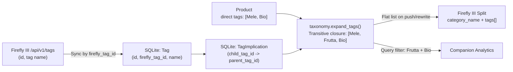

# Spec: Canonical Items, Hierarchical Firefly Tags & Historical Sync — V1

* **Author:** Fabrizio & Antigravity
* **Status:** Implemented
* **Date:** 2026-11-26
* **Related Issues:** [#1](https://github.com/fabriziocacicia/my-firefly/issues/1), [#4](https://github.com/fabriziocacicia/my-firefly/issues/4), [#5](https://github.com/fabriziocacicia/my-firefly/issues/5)
* **Confirmed Intent:** [`docs/intent/items-tags-firefly-sync.md`](../intent/items-tags-firefly-sync.md)

---

## 1. Objective

Redesign item (`Product`) management, tag/category taxonomy, receipt entry, and historical Firefly III synchronization so that:
1. Every catalog **Item** owns its intrinsic metadata: packaging format (`pack_count × unit_size + unit`, or `loose_weight` for items weighed at checkout), one linear **Firefly III category**, and **direct tags** backed by Firefly III tag IDs.
2. **Tag hierarchy / implications** (`Mele → Frutta`, composable with orthogonal tags like `Bio`) are modeled in the companion app on top of flat Firefly III tags, automatically expanded when pushing or syncing to Firefly III, and evaluated transitively in companion-app spending and unit-price analytics.
3. **Receipt Workbench** fixes autocomplete and inline item creation (Issue #4) and strips per-line unit/package inputs (Issue #5), requiring only **Item**, **Quantity / Weight**, and **Price** (supporting either unit price or line total).
4. **Historical Firefly Backlog** allows incremental, manual association of existing Firefly III transactions/splits to canonical companion-app items (filtered by Firefly category with unassociated counts per category), consistently rewriting linked Firefly splits with the item's canonical name, category, and expanded tags.

### Critical User Journeys (CUJs)

- **CUJ 1 — Create Canonical Item Ex-Novo:** From Catalog (`+ New Item`) or inline from a receipt row, create `Mele Rosse Bio 600g` (`packaged`, `1 × 600 g`, category `Groceries`, direct tags `[Mele, Bio]`). Because `Mele → Frutta` is defined in the tag hierarchy, effective tags resolve to `[Mele, Frutta, Bio]`.
- **CUJ 2 — Fast Receipt Entry:** On `ReceiptWorkbench`, type `Mele` → clipped-free autocomplete lists `Mele Rosse Bio 600g (600g · Groceries)` → select it → enter only `Qty = 2` and `Total = 4.50` (or `Unit = 2.25`) → commit row → push to Firefly creates splits with canonical name `Mele Rosse Bio 600g`, category `Groceries`, and tags `["Mele", "Frutta", "Bio"]`.
- **CUJ 3 — Clear Historical Firefly Backlog:** Run `Sync Firefly` → open `Firefly Backlog` tab → filter by category badge `Groceries (42)` → see `"mele rosse bioo 600g" (8 occorrenze)` → click `Associa a oggetto esistente` (`Mele Rosse Bio 600g`) or `Crea nuovo oggetto` → companion app rewrites those 8 Firefly splits safely (preserving sibling splits on multi-split receipts) with description `Mele Rosse Bio 600g`, category `Groceries`, and tags `["Mele", "Frutta", "Bio"]`, and indexes their price/spending records locally.
- **CUJ 4 — Multi-Dimensional Tag Analytics:** Query spending and normalized prices (€/kg, €/L, €/pc) by any single tag (`Frutta`) or tag intersection (`Frutta + Bio`) and include all purchases of items tagged with any descendant (`Mele`).

---

## 2. Assumptions Surface

1. **Firefly III REST API compatibility:** Target instance supports `GET /api/v1/categories`, `GET /api/v1/tags`, `POST /api/v1/tags`, `GET /api/v1/transactions` (paginated), `GET /api/v1/transactions/{id}`, and `PUT /api/v1/transactions/{id}` where preserving every sibling split's `transaction_journal_id` prevents split deletion.
2. **Web application & local SQLite persistence:** Existing React + FastAPI + SQLite (`companion.db` via Alembic) remains the runtime architecture.
3. **Existing `Product` / `Tag` rows:** Any existing local `Tag` rows without a `firefly_tag_id` can be matched by case-insensitive name on first Firefly tag sync (or created in Firefly on push/sync).
4. **Transaction scope for backlog:** Historical item backlog focuses primarily on `withdrawal` transactions (with category filter handling non-grocery withdrawals cleanly).

---

## 3. Tech Stack

- **Backend:** Python 3.11+, FastAPI `>=0.110.0`, SQLModel `>=0.0.16`, Alembic `>=1.13.1`, `httpx >=0.27.0`, SQLite (WAL mode, `PRAGMA foreign_keys = ON`).
- **Frontend:** React `18.2`, TypeScript `5.2`, Vite `5.1`, Tailwind CSS `3.4`, `lucide-react`.
- **External API:** Firefly III REST API v1 (`application/vnd.api+json`).

---

## 4. Commands

```bash
# Backend unit & API tests (inside backend/ virtualenv or container)
docker compose exec backend python -m unittest discover -s tests
# Or locally with backend venv active:
cd backend && python -m unittest discover -s tests

# Frontend type-check & production build
cd frontend && npm run build

# Local dev servers
cd backend && uvicorn app.main:app --reload --port 8000
cd frontend && npm run dev

# Full stack via Docker Compose
docker compose up -d --build
```

---

## 5. Project Structure

```text
backend/
├── app/
│   ├── api/v1/
│   │   ├── products.py          # Item CRUD, aliases, linked Firefly propagation
│   │   ├── tags.py              # Firefly tag sync, hierarchy/implications CRUD, DAG validation
│   │   ├── categories.py        # Firefly categories proxy/cache + account sector categories
│   │   ├── firefly_sync.py      # Historical transaction sync, backlog grouping, link/ignore actions
│   │   ├── analytics.py         # Tag/intersection spending & price intelligence endpoints
│   │   └── receipts.py          # Simplified receipt items & expanded category/tag Firefly push
│   ├── models/
│   │   ├── product.py           # Canonical Product, ItemFireflyAlias
│   │   ├── tag.py               # Tag (Firefly ID-backed) & TagImplication (DAG edges)
│   │   ├── firefly_cache.py     # FireflySyncedSplit (local mirror of Firefly splits)
│   │   ├── receipt.py           # ReceiptItem (inherits/snapshots item metadata)
│   │   └── price.py             # PriceRecord (linked to receipt or synced Firefly split)
│   └── services/
│       ├── firefly.py           # FireflyClient: categories, tags, transactions, safe split PUT
│       ├── taxonomy.py          # DAG cycle check, transitive tag expansion, multi-tag matching
│       └── pricing.py           # Unit price normalization (pack_count * unit_size vs loose_weight)
├── migrations/versions/         # Alembic schema migrations (0009+)
└── tests/                       # unittest suites with mocked FireflyClient & in-memory SQLite

frontend/src/
├── api/client.ts                # Typed API client for items, tag DAG, backlog, analytics
├── components/
│   ├── Catalog/                 # ItemModal, TagHierarchyManager, FireflyBacklogView
│   └── Workbench/               # Clipped-free ProductCombobox, simplified TabularGridView & CardStreamView
└── pages/
    ├── CatalogPage.tsx          # Catalog Items + Firefly Backlog + Tag Hierarchy tabs
    └── ReceiptWorkbenchPage.tsx
```

---

## 6. Architecture & Data Model

### 6.1 Tag Hierarchy & Firefly ID Mapping

Firefly III stores tags as flat strings, each with a numeric Firefly ID (`GET /api/v1/tags`).



- **`Tag` table updates:**
  - `firefly_tag_id: Optional[int]` (unique, indexed)
  - `name: str` (unique, indexed)
  - Keep `group` / `color` optional for UI styling.
- **`TagImplication` table (new):**
  - `child_tag_id: int` (FK `tag.id`, PK)
  - `parent_tag_id: int` (FK `tag.id`, PK)
  - Invariant: `child_tag_id != parent_tag_id`, and adding `(child, parent)` must not introduce a directed cycle (`A → B → A` rejected with `422`).
- **Sync rules:**
  - `POST /api/v1/tags/sync-firefly` pulls `GET /api/v1/tags` paginated, matching by `firefly_tag_id` first, then case-insensitive `name`, updating `name` if renamed in Firefly (preserving permanent ID-based hierarchy links!).
  - Creating a tag in the companion app (`POST /api/v1/tags`) creates it in Firefly III via `POST /api/v1/tags` first (or fetches existing) so every active item tag has a `firefly_tag_id`.

### 6.2 Canonical Item (`Product`) & Packaging Metadata (Issues #1 & #5)

- **`Product` columns:**
  - `name: str` (canonical name, e.g., `"Mele Rosse Bio 600g"`)
  - `sale_mode: Literal["packaged", "loose_weight"]` (default `"packaged"`)
  - `pack_count: int` (default `1`, `>= 1` — e.g., `6` for `6×330ml`)
  - `unit_size: float` (default `1.0`, `> 0` — e.g., `330` for `6×330ml`, `600` for `600g`; `1.0` when `loose_weight`)
  - `default_unit: Literal["g", "kg", "ml", "l", "pcs"]`
  - `package_size: float` (kept in sync as `pack_count * unit_size` for compatibility with existing analytics/normalization)
  - `firefly_category_id: Optional[int]`
  - `firefly_category_name: Optional[str]`
  - `brand_id`, `barcode`, `notes`
- **Unit Price Normalization:**
  - `packaged`: `total_measure = receipt_quantity * pack_count * unit_size`
  - `loose_weight`: `total_measure = receipt_quantity` (entered in `product.default_unit`, e.g., `0.84 kg`)

### 6.3 Receipt Workbench Fixes & Simplified Entry (Issues #4 & #5)

- **Root cause & fix for Issue #4:**
  - `TabularGridView` currently wraps the table in `<div className="overflow-x-auto ...">`, which causes CSS `overflow-y` clipping of `ProductCombobox`'s `position: absolute` dropdown (making autocomplete and the `+ New Product` footer invisible when the table has 0 or few rows).
  - Render `ProductCombobox` dropdown via React `createPortal(..., document.body)` with `getBoundingClientRect()` fixed positioning (repositioning on scroll/resize), so it never clips inside overflow containers or modals.
  - Ensure `InlineProductModal` exposes all canonical item fields: `name`, `brand`, `sale_mode`, `pack_count`, `unit_size`, `default_unit`, `firefly_category_name` (combobox synced from Firefly `/api/v1/categories`), and direct `tags` (with live preview of implied/expanded tags).
- **Simplified Receipt Row (Issue #5):**
  - Remove `Unit` and `Pkg Size` inputs from both `TabularGridView` and `CardStreamView` rows; show packaging, category, and effective tags as a compact read-only badge beneath the product name.
  - Row inputs:
    1. **Item** (`ProductCombobox`)
    2. **Qty / Weight** (defaults to `1` for `packaged`; weight input labeled with `product.default_unit` for `loose_weight`)
    3. **Price** with **Unit / Total** entry toggle: entering `Total = 4.50` with `Qty = 2` computes `paid_price = 2.25` per unit (`line_total = 4.50`), and vice versa.
    4. Optional **Regular Price** & **Sale** flag.
  - Backend `ReceiptCreate` / `ReceiptItemCreate`: `unit` and `package_size` become optional on input and are resolved server-side from the `Product` record (snapshotted onto `ReceiptItem` and `PriceRecord` so historical receipts remain immutable if a product is edited later). For `packaged` items, `quantity` is validated as a positive integer count (`>= 1`); for `loose_weight` items, `quantity` accepts positive decimals (`> 0`).
  - `push-to-firefly`:
    - **1 split per package unit (`packaged`):** Buying `quantity = 5` of `Pasta Barilla Fusilli 1kg` expands into **5 separate splits** on Firefly III, each with `description = product.name`, `category_name = product.firefly_category_name`, and `tags = expanded_tag_names`. `_allocate_receipt_cents` runs across all expanded billable split units so basket discounts and meal-voucher partitioning remain exact to the cent (`>= €0.01` per split).
    - **Single split for `loose_weight`:** Buying `0.84 kg` pushes 1 split with `description = product.name`, `category_name`, `tags`, and weight context (`0.84 kg`) in `notes`.

### 6.4 Historical Firefly Sync, Backlog & Safe Rewrite

- **Local Mirror (`FireflySyncedSplit` & `FireflySyncState` tables):**
  - **Two sync modes** (avoiding heavy full-history scans on every page load):
    1. **Incremental Sync on Page Open / Refresh:** Once an initial sync exists (`last_full_sync_at IS NOT NULL`), opening or refreshing the Backlog/Catalog renders cached SQLite rows immediately and runs a non-blocking incremental `POST /api/v1/firefly-sync/transactions?mode=incremental` (throttled with a 60s cooldown), fetching only `start = high_watermark_date - 7 days` (typically 1–2 API pages).
    2. **Explicit Full Sync Button:** `POST /api/v1/firefly-sync/transactions?mode=full` fetches the complete paginated history (`GET /api/v1/transactions?type=withdrawal`) for initial backfill or re-reconciling edits older than 7 days.
  - `FireflySyncedSplit` columns:
    - `transaction_journal_id: int` (unique indexed — Firefly's individual split ID)
    - `firefly_transaction_id: int` (indexed — parent transaction group ID)
    - `tx_date: date`, `amount_cents: int`, `description: str`
    - `firefly_expense_account_id: Optional[int]`, `firefly_expense_account_name: Optional[str]`
    - `firefly_category_name: Optional[str]`
    - `tags_json: str` (JSON list of strings)
    - `linked_product_id: Optional[int]` (FK `product.id`, indexed)
    - `is_ignored: bool` (default `False`)
    - `synced_at: datetime`
- **`ItemFireflyAlias` table:**
  - `id: int`, `product_id: int` (FK `product.id`), `raw_description: str`, `normalized_description: str` (lowercased/trimmed, indexed).
  - Records historical Firefly descriptions explicitly associated with an item (e.g., `"mele rosse bioo 600g"` → `Mele Rosse Bio 600g`) so subsequent syncs can recognize or flag newly imported matching aliases cleanly.
- **Explicit Confirmation for Propagating Subsequent Edits:**
  - Editing an existing `Product` (name, category, direct tags) or `TagImplication` saves locally first and computes `affected_firefly_transaction_count` across linked splits (`FireflySyncedSplit` + pushed `Receipt` transactions).
  - No silent Firefly rewrite occurs on edit; the UI prompts for explicit user confirmation (`"Update N linked transactions in Firefly III?"`) before executing the `PUT` batch.
- **Backlog Query & Category Filter:**
  - `GET /api/v1/firefly-sync/backlog?category=...&search=...`:
    - Computes unassociated (`linked_product_id IS NULL AND is_ignored = FALSE`) split groups grouped by `(normalized_description, firefly_category_name)`, returning `sample_description`, `category_name`, `occurrence_count`, `total_amount`, `latest_date`, and `sample_stores`.
    - Also returns `category_counts`: `[{ category_name: "Groceries", count: 42 }, { category_name: null, count: 18 }, ...]` representing unassociated split counts per Firefly category.
- **Link & Safe Firefly Rewrite Protocol:**
  - Actions on a backlog group:
    1. `POST /api/v1/firefly-sync/backlog/link`: links all matching unlinked `transaction_journal_id`s to an existing `product_id` (or creates a new `Product` first), records `ItemFireflyAlias`, creates/updates `PriceRecord` entries (deduplicated by `transaction_journal_id`), and rewrites Firefly splits.
    2. `POST /api/v1/firefly-sync/backlog/ignore`: sets `is_ignored = True` for non-product descriptions.
  - **Safe `PUT /api/v1/transactions/{id}` Rule (CRITICAL):**
    - Group target `transaction_journal_id`s by parent `firefly_transaction_id`.
    - For each parent `firefly_transaction_id`:
      1. `GET /api/v1/transactions/{id}` to retrieve the authoritative current list of splits.
      2. Construct `transactions` array containing **every split** in the group:
         - Untouched sibling splits MUST pass `{"transaction_journal_id": sibling_journal_id}` (so Firefly III never deletes sibling splits!).
         - Matched splits pass `{"transaction_journal_id": target_journal_id, "description": product.name, "category_name": product.firefly_category_name, "tags": expanded_tag_names}`.
      3. Send `PUT /api/v1/transactions/{id}` with `"apply_rules": false, "fire_webhooks": false`.
      4. Update `FireflySyncedSplit` locally only after Firefly returns HTTP 2xx; report partial failures explicitly per transaction ID for retry.

---

## 7. Code Style

Follow existing SQLModel + FastAPI + Pydantic v2 conventions in `backend/app/` and typed React + Tailwind components in `frontend/src/`:

```python
def expand_tag_ids(
    direct_tag_ids: list[int],
    implications: dict[int, set[int]],
) -> set[int]:
    """Computes transitive closure of direct tags through TagImplication edges."""
    expanded: set[int] = set()
    stack = list(direct_tag_ids)
    while stack:
        current = stack.pop()
        if current in expanded:
            continue
        expanded.add(current)
        stack.extend(implications.get(current, ()))
    return expanded
```

---

## 8. Testing Strategy

- **Backend (`backend/tests/`):**
  - `test_tag_hierarchy.py`: cycle rejection (`422`), multi-hop transitive expansion (`Mele → Frutta → Food` + `Bio`), Firefly tag ID sync/rename preservation, multi-tag intersection filtering (`Frutta + Bio`).
  - `test_canonical_items_and_receipts.py`: `packaged` (`6×330ml`) vs `loose_weight` (`kg`) normalization, `ReceiptCreate` deriving unit/package from `Product`, `push-to-firefly` payload verification (`description = product.name`, `category_name`, expanded `tags`).
  - `test_firefly_backlog_sync.py`: mocked `FireflyClient` pagination sync, backlog grouping & category counts, and **critical test asserting `PUT /api/v1/transactions/{id}` always includes untouched sibling `transaction_journal_id`s** on multi-split transactions.
- **Frontend (`frontend/`):**
  - `npm run build` (`tsc && vite build`) passes with zero TypeScript or bundler errors.
  - Browser DevTools verification of `ProductCombobox` dropdown visibility inside `TabularGridView` (0 rows and >1 rows) and `InlineProductModal` creation flow.

---

## 9. Boundaries

- **Always:**
  - Preserve every sibling `transaction_journal_id` when calling `PUT /api/v1/transactions/{id}` (verify via `GET` before `PUT`).
  - Run backend `unittest` suite and `npm run build` before committing changes.
  - Validate DAG acyclicity before saving any `TagImplication`.
  - Keep database changes in versioned Alembic migrations (`0009+`).
- **Ask First:**
  - Before running bulk historical `PUT` rewrites against a live Firefly III instance during manual testing.
  - Before adding any new Python or npm dependencies.
- **Never:**
  - Auto-link historical Firefly transactions to items without explicit user confirmation.
  - Send `PUT /api/v1/transactions/{id}` with omitted sibling split IDs (would permanently delete splits in Firefly III).
  - Commit secrets (`.env`, `FIREFLY_TOKEN`) or temporary scratchpads to Git.

---

## 10. Success Criteria

1. `ProductCombobox` autocomplete and inline product creation work without clipping in both Grid and Card views on `ReceiptWorkbench` (Issue #4 resolved).
2. Adding a packaged item on a receipt requires only item, quantity (default `1`), and price (unit or total), while packaging (`pack_count`, `unit_size`, `default_unit`) lives strictly on the `Product` (Issue #5 resolved); pushing `N` packs of a packaged item produces `N` uniform splits on Firefly III with exact cent allocation.
3. Each `Product` stores a Firefly category and direct Firefly-ID-backed tags; tag implications (`A → B`) expand flatly onto Firefly III splits on both receipt push and historical backlog linking (Issue #1 resolved), and subsequent metadata/hierarchy edits ask explicit confirmation before propagating to Firefly.
4. `CatalogPage` provides `+ New Item` ex-novo creation, fast incremental sync on page open/refresh plus a manual Full Sync button, and a `Firefly Backlog` view grouped by unassociated descriptions with occurrence counts and Firefly-category filter counts (`Ignore`, `Link to existing item`, `Create item from entry`) that safely update Firefly III splits.
5. Analytics endpoints answer spending and normalized unit-price queries for any single tag or tag combination across both companion-app receipts and linked Firefly history.

---

## 11. Out of Scope (Deferred to V2)

- **V2-1:** Automated fuzzy/AI suggestions for linking Firefly descriptions without user trigger.
- **V2-2:** Automatic background webhook/cron polling of Firefly III (V1 uses lightweight incremental sync on page open/refresh + manual Full Sync).
- **V2-3:** Receipt OCR / automatic line-item extraction from uploaded PDF/HEIC images.
- **V2-4:** Multi-currency item price conversion.

---

## 12. Resolved Decisions

1. **Multi-split expansion on Firefly (`push-to-firefly`):** Buying `N` packs of a `packaged` item (e.g., `5` packs of `Pasta Barilla Fusilli 1kg`) creates **`N` separate splits** on Firefly III, each with `description = product.name`, `category_name`, and expanded `tags`. `loose_weight` items push 1 split with weight in `notes`.
2. **Propagating subsequent edits to Firefly:** Editing an item's name, category, direct tags, or tag hierarchy saves locally and always asks **explicit confirmation** (`"Update N linked transactions?"`) before running `PUT` updates on Firefly III.
3. **Sync on refresh vs Full Sync:** Full history scan runs only via explicit **Full Sync**; subsequent page opens/refreshes render local cache immediately and trigger a non-blocking **incremental delta sync** (`high_watermark_date - 7 days`, 60s cooldown), keeping refresh overhead minimal (~1–2 pages).
