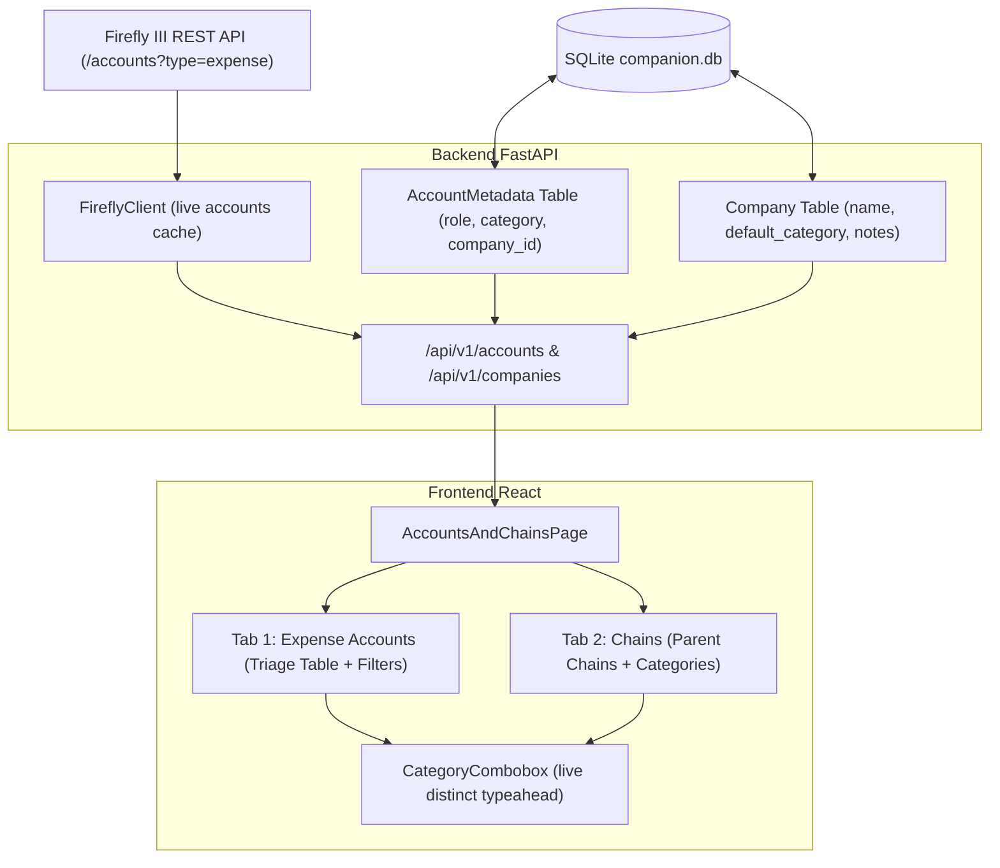

# Accounts & Chains: Expense Account Classification & Category Tagging

*   **Author:** Fabrizio & Antigravity
*   **Status:** Proposed (Under Review)
*   **Date:** 2026-11-23
*   **Issue:** [#13](https://github.com/fabriziocacicia/my-firefly/issues/13)

--------------------------------------------------------------------------------

## 1. Overview

`my-firefly` is a companion application for Firefly III that handles itemized grocery receipts, split transactions, and product price tracking. Today, all 290+ expense accounts fetched from Firefly III are displayed in a flat list on the `Stores` page. While accounts can optionally be linked to a parent `Company` (e.g. `Conad Via Roma` → `Conad`), there is no mechanism to:
1. Classify the nature of an expense account (Chain Branch, Independent Business, or personal contact such as a Person).
2. Assign merchant category tags (e.g. `Supermarket`, `Pharmacy`, `Gas Station`, `Utility`) to parent chains or independent businesses for downstream spending analytics.

This design introduces a **Lean Account Classification & Category Tagging** system. It unifies account triage and chain management under a single, accurately titled hub: **`Accounts & Chains`**, featuring two dedicated tabs (`Expense Accounts` and `Chains`). Accounts default safely to `Unclassified` with zero upfront configuration required, while categories are created entirely on the fly via a clean-slate type-ahead combobox.

---

## 2. The Problem

1. **Flat, Heterogeneous Expense Accounts:** In Firefly III, *every* destination of funds is an "Expense Account". A single flat list contains supermarket branches (`Conad Via Roma`), utilities (`Enel Energia`), subscriptions (`Netflix`), independent artisans (`Panificio Rossi`), and personal contacts (`Alice`, `Bob`). Without classification, there is no way to know which accounts are commercial merchants vs. personal contacts.
2. **Missing Sector/Category Taxonomy:** There is no mechanism to record business sectors (e.g. `Supermarket`, `Pharmacy`, `Gas Station`). Consequently, future macro-spending questions like *"How much did I spend at supermarkets last month?"* cannot be answered.
3. **Misleading Page Semantics:** The current page is titled `Stores`, which misrepresents the data: personal contacts and utility companies are not stores, and parent retail chains (`Company`) are not Firefly expense accounts.
4. **Risk of Bureaucratic Overhead:** Forcing users to create a parent `Company` record just to tag a single independent bakery (`Panificio Rossi`) clutters the database with hundreds of 1:1 dummy company records.

---

## 3. Goals & Non-Goals

### Goals
*   **G1: Clean Account Nature Classification:** Enable each Firefly expense account to be designated with a role:
    *   `Unclassified` (Default: zero SQLite rows needed, zero breakage).
    *   `Person`: Personal contact (friend, family, roommate); excluded from merchant category tagging.
    *   `Chain Branch`: Branch belonging to a parent retail chain; inherits the chain's category tag.
    *   `Independent Business`: Standalone business; holds its own category tag directly without needing a dummy `Company` record.
*   **G2: On-the-Fly, Clean-Slate Category Tagging:** Provide a type-ahead combobox for category assignment that starts with zero hardcoded presets and dynamically suggests existing user-created categories as the user types.
*   **G3: Accurate Page Architecture (`Accounts & Chains`):** Replace the old `Stores` navigation item and page with `Accounts & Chains`, cleanly separated into two tabs:
    *   **Tab 1 (`Expense Accounts`):** Live Firefly expense accounts with fast inline triage and filtering.
    *   **Tab 2 (`Chains`):** Parent retail chains table with category management and linked store counts.
*   **G4: Seamless Category Inheritance:** When a parent chain's category is updated, all linked branches immediately inherit and reflect the new category across all queries.
*   **G5: Non-Destructive Progressive Migration:** Existing `CompanyAccountLink` records automatically migrate to `AccountMetadata` rows with `role = 'chain'`. Unclassified accounts require zero database rows.

### Non-Goals
*   **NG1: Spending Analytics & Charts:** Building aggregation charts, monthly totals, or reporting dashboards by category is deferred to a follow-up feature.
*   **NG2: Receipt Side-Effects:** Changing Receipt Workbench, Catalog store pickers, or Firefly transaction push payloads is strictly excluded. All expense accounts remain 100% selectable across receipt entry.
*   **NG3: Hardcoded Category Presets:** Bundling an opinionated, static enum of category names in the application code is excluded.
*   **NG4: Mandatory Upfront Triage:** Enforcing that accounts must be classified before they can be used is excluded.

---

## 4. Critical User Journeys (CUJs)

### CUJ 1: Progressive Safe Triage from Directory
*   **Given:** The user has 290+ accounts in Firefly III and opens `Accounts & Chains`.
*   **When:** The user navigates to the `Expense Accounts` tab.
*   **Then:** All accounts are loaded cleanly. Unclassified accounts show a neutral `[ Unclassified ▾ ]` role badge with zero errors. The user clicks the selector on `Alice`, picks `Person`, and it instantly updates to a subtle gray `[ 👤 Person ]` badge.

### CUJ 2: Tagging an Independent Merchant
*   **Given:** The user sees a standalone local shop `Panificio Rossi`.
*   **When:** The user sets the role to `Independent Business`.
*   **Then:** An inline category combobox appears. The user types `"Bak..."`, sees no existing tag, types `"Bakery"`, and presses Enter to create and assign it. The account now holds `category = "Bakery"` directly in `AccountMetadata` without creating a row in the `Company` table.

### CUJ 3: Linking a Chain Branch & Category Inheritance
*   **Given:** The user sees `Conad Via Roma` (currently unclassified).
*   **When:** The user sets the role to `Chain Branch` and selects `Conad` from the company combobox.
*   **Then:** The account links to `Conad`. Because `Conad` has category `"Supermarket"` set in the `Chains` tab, `Conad Via Roma` immediately displays the inherited badge `[ Supermarket ]`.

### CUJ 4: Managing Chains & Updating Sectors
*   **Given:** The user switches to the `Chains` tab.
*   **When:** The user sees `Conad`, `Lidl`, and `Eni`, along with their branch counts (e.g. `Conad (5 stores)`).
*   **Then:** The user edits `Eni`'s category to `"Gas Station"`. All accounts linked to `Eni` immediately reflect `"Gas Station"` across all views.

---

## 5. Technical Plan (Architecture)

### 5.1 System Topology & Data Flow



---

### 5.2 Data Model (`backend/app/models/`)

#### 1. `AccountMetadata` Model (`backend/app/models/account_metadata.py`)
Replaces and extends `CompanyAccountLink`:

```python
from datetime import datetime, timezone
from enum import Enum
from typing import Optional
from sqlmodel import SQLModel, Field, Relationship

class AccountRole(str, Enum):
    UNCLASSIFIED = "unclassified"
    PERSON = "person"
    CHAIN = "chain"
    INDEPENDENT = "independent"

class AccountMetadataBase(SQLModel):
    role: AccountRole = Field(default=AccountRole.UNCLASSIFIED, index=True)
    category: Optional[str] = Field(default=None, index=True)  # Set when role == INDEPENDENT
    company_id: Optional[int] = Field(default=None, foreign_key="company.id", index=True)
    notes: Optional[str] = Field(default=None)

class AccountMetadata(AccountMetadataBase, table=True):
    __tablename__ = "account_metadata"

    firefly_account_id: int = Field(primary_key=True)
    created_at: datetime = Field(default_factory=lambda: datetime.now(timezone.utc))
    updated_at: datetime = Field(default_factory=lambda: datetime.now(timezone.utc))

    company: Optional["Company"] = Relationship(back_populates="account_metadatas")

class AccountMetadataUpdate(SQLModel):
    role: AccountRole
    category: Optional[str] = None
    company_id: Optional[int] = None
    notes: Optional[str] = None
```

#### 2. `Company` Model (`backend/app/models/company.py`)
Retained for multi-location retail chains:

```python
class CompanyBase(SQLModel):
    name: str = Field(index=True, unique=True)
    default_category: Optional[str] = Field(default=None, index=True)  # The chain's sector
    notes: Optional[str] = Field(default=None)

class Company(CompanyBase, table=True):
    id: Optional[int] = Field(default=None, primary_key=True)
    created_at: datetime = Field(default_factory=lambda: datetime.now(timezone.utc))

    account_metadatas: List[AccountMetadata] = Relationship(
        back_populates="company", cascade_delete=True
    )
```

#### 3. Database Migration
*   Create table `account_metadata`.
*   Migrate existing rows from `company_account_link`:
    ```sql
    INSERT INTO account_metadata (firefly_account_id, role, company_id, created_at, updated_at)
    SELECT firefly_account_id, 'chain', company_id, created_at, created_at
    FROM company_account_link;
    ```
*   Drop legacy table `company_account_link`.

---

### 5.3 REST API Contracts

#### 1. Enriched Expense Accounts Directory
`GET /api/v1/firefly/expense-accounts`
*   Returns Firefly expense accounts merged with local `AccountMetadata` and inherited company details.
*   **Response Schema (`EnrichedExpenseAccountRead`):**
    ```json
    [
      {
        "id": 101,
        "name": "Conad Via Roma",
        "role": "chain",
        "category": "Supermarket",
        "is_inherited_category": true,
        "company_id": 1,
        "company_name": "Conad"
      },
      {
        "id": 102,
        "name": "Panificio Rossi",
        "role": "independent",
        "category": "Bakery",
        "is_inherited_category": false,
        "company_id": null,
        "company_name": null
      },
      {
        "id": 103,
        "name": "Alice",
        "role": "person",
        "category": null,
        "is_inherited_category": false,
        "company_id": null,
        "company_name": null
      },
      {
        "id": 104,
        "name": "Enel Energia",
        "role": "unclassified",
        "category": null,
        "is_inherited_category": false,
        "company_id": null,
        "company_name": null
      }
    ]
    ```

#### 2. Update Account Metadata
`PUT /api/v1/accounts/{account_id}/metadata`
*   **Request Body:**
    ```json
    {
      "role": "independent",
      "category": "Bakery",
      "company_id": null
    }
    ```
*   **Validation Rules:**
    *   If `role == "chain"`: `company_id` is required; `category` must be null (inherited from company).
    *   If `role == "person"` or `"unclassified"`: `company_id` and `category` are cleared/null.
    *   If `role == "independent"`: `company_id` is null; `category` is an optional trimmed string.

#### 3. Category Typeahead Autocomplete
`GET /api/v1/categories`
*   Returns distinct, non-empty, sorted category strings from both `Company.default_category` and `AccountMetadata.category`.
*   **Response:** `["Bakery", "Drugstore", "Gas Station", "Pharmacy", "Supermarket"]`

---

### 5.4 Frontend UI Architecture (`frontend/src/`)

#### 1. Navigation & Routing
*   Rename route `/stores` to `/accounts-and-chains`. (Provide redirect from `/stores` for seamless bookmark compatibility).
*   In `Navbar.tsx`, update link text to **`Accounts & Chains`** with an appropriate icon (`Store` + `Users` or `Building2`).

#### 2. Page Layout: `AccountsAndChainsPage.tsx`
*   **Header:** "Accounts & Chains" — subtitle: "Classify expense accounts and manage retail chains".
*   **Tabs:**
    *   `[ Expense Accounts (294) ]`
    *   `[ Chains (12) ]`

#### 3. Tab 1: Expense Accounts View
*   **Controls Bar:**
    *   Search input (matches account name, company name, or category tag).
    *   Filter Chips: `All (294)` | `Chains (48)` | `Independent (32)` | `Persons (18)` | `Unclassified (196)`.
    *   **View Switcher Toggle:** Switchable between **Quiet Cards (Grid)** and **High-Density Table**, with persistence in `localStorage`.
*   **Quiet Cards Grid View:**
    *   **Unclassified cards:** Clean and quiet. Displays account icon, name, `#id`, and a single subtle `[Classify]` button. Zero invasive segmented control strips and zero redundant explanatory text.
    *   **Classified cards:** Compact tile displaying the assigned badge:
        *   `Chain`: `[Building2] Company Name` + Category pill (e.g. `[Drugstore]`) + `[Edit]` button.
        *   `Independent`: `[Store] Independent Shop` + Category pill (e.g. `[Bakery]`) + `[Edit]` button.
        *   `Person`: `[User] Personal Contact` + `[Edit]` button.
*   **High-Density Table View:**
    *   Fast scanning table for managing 300+ accounts.
    *   Dynamic contextual columns based on active filter:
        *   `All`: `Account`, `Role`, `Chain`, `Category Tag`, `Actions`
        *   `Chains`: `Account`, `Parent Chain`, `Category Tag`, `Actions` (`Role` omitted as redundant)
        *   `Independent`: `Account`, `Category Tag`, `Actions` (`Role` and `Chain` omitted)
        *   `Persons`: `Account`, `Actions` (`Role`, `Chain`, and `Category` omitted)
        *   `Unclassified`: `Account`, `Actions` (`Role`, `Chain`, and `Category` omitted)
*   **Unified Classification Modal (`classifyingAccount`):**
    *   Triggered from both Grid and Table views when clicking `[Classify]` or `[Edit]`.
    *   Role Selector: 4 clean tiles (`Chain Branch`, `Independent Store`, `Personal Contact`, `Unclassified`).
    *   Conditional Form:
        *   If `Chain`: `CompanyCombobox` to search/create parent retail chain.
        *   If `Independent`: `CategoryCombobox` to search/create sector tag.
        *   If `Person`: clear note that personal contacts are excluded from commercial categories.
        *   If `Unclassified`: clear note confirming default standard account state.
    *   Saves via `PUT /api/v1/accounts/{id}/metadata`.

#### 4. Tab 2: Chains View
*   **Controls Bar:** "New Parent Chain" modal button.
*   **Chains Table:**
    *   Columns: Chain Name, Category Tag (editable inline via `CategoryCombobox`), Linked Store Count, Actions (Edit, Delete).
    *   Deleting a chain unlinks member accounts, setting their role to `unclassified`.

#### 5. Component: `CategoryCombobox.tsx`
*   Accessible type-ahead search with floating dropdown.
*   Fetches current categories from `GET /api/v1/categories`.
*   If user types `"Phar"`, highlights `"Pharmacy"`.
*   If user types a novel term `"Pet Store"`, displays `"+ Create 'Pet Store'"`.
*   Zero pre-baked presets.

---

## 6. Testing Strategy

### Backend Tests
*   `tests/test_account_metadata.py`:
    *   Test setting role to `person` clears any lingering `company_id` and `category`.
    *   Test setting role to `chain` validates that `company_id` exists and propagates category inheritance.
    *   Test setting role to `independent` persists direct category.
    *   Test `GET /api/v1/categories` aggregates distinct categories across companies and accounts.
    *   Test unclassified accounts return correct defaults without database rows.

### Frontend Verification
*   Type-check verification via TypeScript (`tsc`).
*   Component state verification for role switching and category combobox interactions.

---

## 7. Boundaries

*   **Always do:**
    *   Keep unclassified accounts functional and non-blocking everywhere.
    *   Keep Receipt Workbench and transaction push logic 100% untouched.
    *   Trim category strings and treat lookups case-insensitively.
*   **Ask first:**
    *   Changing database migrations or removing existing columns.
    *   Modifying Firefly III client sync frequency.
*   **Never do:**
    *   Filter out `Person` accounts from the Receipt Workbench or Catalog pickers.
    *   Hardcode a static enum of categories in the frontend or backend.
    *   Delete or alter Firefly III accounts via the REST API.

---

## 8. Success Criteria

1. Every expense account can be assigned to `Unclassified`, `Person`, `Chain Branch`, or `Independent Business`.
2. Chains and Independent Businesses can be tagged with custom categories via a clean-slate type-ahead combobox.
3. Chain branches automatically inherit and display their parent chain's category tag.
4. Accounts left unclassified cause zero warnings, errors, or regressions in any part of `my-firefly`.
5. The navigation and page are clearly titled `Accounts & Chains` with dedicated tabs for `Expense Accounts` and `Chains`.
6. Receipt entry and transaction push remain 100% backward-compatible and functional.

---

## 9. Out of Scope (Deferred)

*   **Spending Analytics by Category:** Aggregating transactions or receipts into monthly spend charts by category (deferred to follow-up issue).
*   **Automatic Account Clustering:** Heuristic auto-tagging based on account name strings (deferred to future refinement).
*   **Liability Account Splitting:** Handling friends' liability accounts during receipt splits (deferred to a separate design).

---

## 10. Open Questions

*   None remaining. Architecture and design are fully specified.
