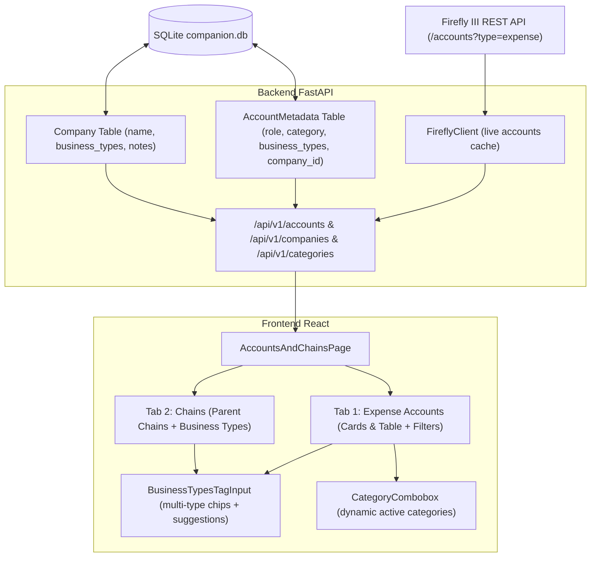

# Accounts & Chains: Expense Account Classification & Category Tagging

*   **Author:** Fabrizio & Antigravity
*   **Status:** Accepted (Implemented)
*   **Date:** 2026-11-24
*   **Issue:** [#13](https://github.com/fabriziocacicia/my-firefly/issues/13)

--------------------------------------------------------------------------------

## 1. Overview

`my-firefly` is a companion application for Firefly III that handles itemized grocery receipts, split transactions, and product price tracking. All 290+ expense accounts fetched from Firefly III are managed via the dedicated hub: **`Accounts & Chains`**, featuring two tabs (`Expense Accounts` and `Chains`).

This specification defines the **Expense Account Classification, Multi-Type Business Modeling & Dynamic Category Tagging** system:
1. **Six-Role Classification:** Expense accounts are classified as `Local Business`, `Chain Branch`, `E-Commerce`, `Service`, `Person`, or `Unclassified`.
2. **Multi-Type Business Modeling (`business_types`):** Physical shops and retail chains can hold multiple activity types (e.g. `[Bar/Cafe, Tobacconist]`). Retail chain branches automatically inherit their parent chain's business types and can extend them with branch-specific types.
3. **Sector Tagging with Dynamic Garbage Collection (`category`):** E-Commerce and Digital Services are tagged with a merchandise or service sector (optional on Local Businesses). Chains rely strictly on `business_types`. If a category tag is unassigned from all accounts, it is automatically removed and never suggested again (zero administrative overhead).

---

## 2. The Problem

1. **Flat, Heterogeneous Expense Accounts:** In Firefly III, *every* destination of funds is an "Expense Account". A single flat list contains supermarket branches (`Conad Via Roma`), utilities (`Enel Energia`), subscriptions (`Netflix`), independent artisans (`Panificio Rossi`), and personal contacts (`Alice`, `Bob`). Without classification, there is no way to know which accounts are commercial merchants vs. personal contacts.
2. **Missing Sector/Category Taxonomy:** There is no mechanism to record business sectors (e.g. `Supermarket`, `Pharmacy`, `Gas Station`). Consequently, future macro-spending questions like *"How much did I spend at supermarkets last month?"* cannot be answered.
3. **Misleading Page Semantics:** The current page is titled `Stores`, which misrepresents the data: personal contacts and utility companies are not stores, and parent retail chains (`Company`) are not Firefly expense accounts.
4. **Risk of Bureaucratic Overhead:** Forcing users to create a parent `Company` record just to tag a single independent bakery (`Panificio Rossi`) clutters the database with hundreds of 1:1 dummy company records.

---

## 3. Goals & Non-Goals

### Goals
*   **G1: Six-Role Account Classification:** Enable each Firefly expense account to be designated with an accurate role:
    *   `Unclassified` (Default: zero SQLite rows needed, zero breakage).
    *   `Person`: Physical peer or personal contact (friend, family); excluded from commercial tags.
    *   `Local Business`: Standalone physical venue; supports multiple `business_types` (e.g. `[Bar/Cafe, Tobacconist]`) and an optional sector category tag.
    *   `Chain Branch`: Branch belonging to a parent retail chain; inherits the chain's `business_types` and can add branch-specific local types.
    *   `E-Commerce`: Online shopping platform; supports a dedicated sector category tag (e.g. `Electronics`, `Supplements`).
    *   `Service`: Digital subscription or service provider (e.g. `Streaming`, `Hosting`).
*   **G2: Multi-Type Business Modeling (`business_types`):** Support array of string tags describing activities of physical shops and chains, with branch inheritance and deduplication.
*   **G3: Zero-Maintenance Category Tagging with Dynamic Cleanup:** Provide a type-ahead combobox for sector categories (`category`). Unassigned categories are automatically removed from suggestions and database queries (no manual category management needed).
*   **G4: Accurate Hub Architecture (`Accounts & Chains`):** Two dedicated tabs (`Expense Accounts` and `Chains`) with Quiet Cards (Grid) and High-Density Table views.
*   **G5: Non-Destructive Progressive Migration:** Existing `CompanyAccountLink` records automatically migrate to `AccountMetadata`. Legacy `default_category` strings on chains are safely migrated to `business_types` via Alembic migration `0007`.

### Non-Goals
*   **NG1: Spending Analytics & Charts:** Building aggregation charts, monthly totals, or reporting dashboards by category is deferred to a follow-up feature.
*   **NG2: Receipt Side-Effects:** Changing Receipt Workbench, Catalog store pickers, or Firefly transaction push payloads is strictly excluded. All expense accounts remain 100% selectable across receipt entry.
*   **NG3: Hardcoded Category Presets:** Bundling an opinionated, static enum of category names in the application code is excluded.
*   **NG4: Mandatory Upfront Triage:** Enforcing that accounts must be classified before they can be used is excluded.

---

## 4. Critical User Journeys (CUJs)

### CUJ 1: Progressive Safe Triage from Directory
*   **Given:** The user has 290+ accounts in Firefly III and opens `Accounts & Chains`.
*   **When:** The user navigates to the `Expense Accounts` tab.
*   **Then:** All accounts are loaded cleanly. Unclassified accounts show a neutral `[ Unclassified ▾ ]` role badge with zero errors. The user clicks the selector on `Alice`, picks `Person`, and it instantly updates to a subtle gray `[ 👤 Person ]` badge.

### CUJ 2: Tagging a Local Business with Multiple Types
*   **Given:** The user sees a local shop `Bar Tabacchi Centrale`.
*   **When:** The user sets the role to `Local Business` and adds types `Bar/Cafe` and `Tobacconist`.
*   **Then:** Both tags are saved in `business_types = ["Bar/Cafe", "Tobacconist"]` in `AccountMetadata` directly without needing a dummy `Company` record.

### CUJ 3: Linking a Chain Branch & Business Type Inheritance
*   **Given:** The user sees `Burger King Tirana` (currently unclassified).
*   **When:** The user sets the role to `Chain Branch` and selects parent chain `Burger King`.
*   **Then:** The account links to `Burger King`. Because `Burger King` has `business_types = ["Fast Food"]`, `Burger King Tirana` automatically displays `[CHAIN: Fast Food]`. If the user adds `Drive-thru`, the effective types become `["Fast Food", "Drive-thru"]`.

### CUJ 4: Managing Chains & Updating Types
*   **Given:** The user switches to the `Chains` tab.
*   **When:** The user sees `Conad`, `Lidl`, and `Eni`, along with their branch counts (e.g. `Conad (5 stores)`).
*   **Then:** The user edits `Eni`'s types to include `Gas Station` and `Carwash`. All branches linked to `Eni` immediately inherit and reflect these types across all views.

---

## 5. Technical Plan (Architecture)

### 5.1 System Topology & Data Flow



---

### 5.2 Data Model (`backend/app/models/`)

#### 1. `AccountMetadata` Model (`backend/app/models/account_metadata.py`)

```python
from datetime import datetime, timezone
from enum import Enum
from typing import Optional, List
from sqlmodel import SQLModel, Field, Relationship

class AccountRole(str, Enum):
    UNCLASSIFIED = "unclassified"
    PERSON = "person"
    CHAIN = "chain"
    LOCAL_BUSINESS = "local_business"
    PHYSICAL_STORE = "physical_store"  # Legacy compatibility alias
    ECOMMERCE = "ecommerce"
    SERVICE = "service"
    INDEPENDENT = "independent"        # Legacy compatibility alias

class AccountMetadataBase(SQLModel):
    role: AccountRole = Field(default=AccountRole.UNCLASSIFIED, index=True)
    category: Optional[str] = Field(default=None, index=True)
    business_types: List[str] = Field(
        default_factory=list,
        sa_column=sa.Column(JSONListType(), nullable=True, server_default="[]"),
    )
    company_id: Optional[int] = Field(default=None, foreign_key="company.id", index=True)
    notes: Optional[str] = Field(default=None)

class AccountMetadata(AccountMetadataBase, table=True):
    __tablename__ = "account_metadata"

    firefly_account_id: int = Field(primary_key=True)
    created_at: datetime = Field(default_factory=lambda: datetime.now(timezone.utc))
    updated_at: datetime = Field(default_factory=lambda: datetime.now(timezone.utc))

    company: Optional["Company"] = Relationship(back_populates="account_metadatas")

class AccountMetadataUpdate(SQLModel):
    role: AccountRole
    category: Optional[str] = None
    business_types: Optional[List[str]] = None
    company_id: Optional[int] = None
    notes: Optional[str] = None
```

#### 2. `Company` Model (`backend/app/models/company.py`)
Retained for multi-location retail chains:

```python
class CompanyBase(SQLModel):
    name: str = Field(index=True, unique=True)
    business_types: List[str] = Field(
        default_factory=list,
        sa_column=sa.Column(JSONListType(), nullable=True, server_default="[]"),
    )
    default_category: Optional[str] = Field(default=None)  # Deprecated; migrated to business_types
    notes: Optional[str] = Field(default=None)

class Company(CompanyBase, table=True):
    id: Optional[int] = Field(default=None, primary_key=True)
    created_at: datetime = Field(default_factory=lambda: datetime.now(timezone.utc))

    account_metadatas: List[AccountMetadata] = Relationship(
        back_populates="company", cascade_delete=True
    )
```

#### 3. Database Migration
*   Create table `account_metadata`.
*   Migrate existing rows from `company_account_link`:
    ```sql
    INSERT INTO account_metadata (firefly_account_id, role, company_id, created_at, updated_at)
    SELECT firefly_account_id, 'chain', company_id, created_at, created_at
    FROM company_account_link;
    ```
*   Drop legacy table `company_account_link`.

---

### 5.3 REST API Contracts

#### 1. Enriched Expense Accounts Directory
`GET /api/v1/firefly/expense-accounts`
*   Returns Firefly expense accounts merged with local `AccountMetadata` and inherited company details.
*   **Response Schema (`EnrichedExpenseAccountRead`):**
    ```json
    [
      {
        "id": 101,
        "name": "Conad Via Roma",
        "role": "chain",
        "category": null,
        "is_inherited_category": false,
        "company_id": 1,
        "company_name": "Conad",
        "business_types": [],
        "inherited_business_types": ["Supermarket"],
        "effective_business_types": ["Supermarket"]
      },
      {
        "id": 102,
        "name": "Bar Tabacchi Centrale",
        "role": "local_business",
        "category": null,
        "is_inherited_category": false,
        "company_id": null,
        "company_name": null,
        "business_types": ["Bar/Cafe", "Tobacconist"],
        "inherited_business_types": [],
        "effective_business_types": ["Bar/Cafe", "Tobacconist"]
      },
      {
        "id": 103,
        "name": "Alice",
        "role": "person",
        "category": null,
        "is_inherited_category": false,
        "company_id": null,
        "company_name": null,
        "business_types": [],
        "inherited_business_types": [],
        "effective_business_types": []
      },
      {
        "id": 104,
        "name": "Amazon",
        "role": "ecommerce",
        "category": "Electronics",
        "is_inherited_category": false,
        "company_id": null,
        "company_name": null,
        "business_types": [],
        "inherited_business_types": [],
        "effective_business_types": []
      }
    ]
    ```

#### 2. Update Account Metadata
`PUT /api/v1/accounts/{account_id}/metadata`
*   **Request Body:**
    ```json
    {
      "role": "local_business",
      "category": null,
      "business_types": ["Bar/Cafe", "Tobacconist"],
      "company_id": null
    }
    ```
*   **Validation & Invariant Rules:**
    *   If `role == "chain"`: `company_id` is required; `category` is set to null (chains use `business_types`); any branch types matching inherited types are automatically deduplicated.
    *   If `role == "person"` or `"unclassified"`: `company_id`, `category`, and `business_types` are cleared.
    *   If `role == "local_business"`: `company_id` is cleared; supports `business_types` list and optional `category`.
    *   If `role == "ecommerce"` or `"service"`: `company_id` and `business_types` are cleared; supports sector `category`.

#### 3. Category Typeahead Autocomplete
`GET /api/v1/categories`
*   Returns distinct, non-empty, sorted category strings from active non-chain accounts in `AccountMetadata.category` (chains use `business_types`).
*   **Dynamic Garbage Collection:** Disappears dynamically if no accounts are tagged with that category. Zero manual database maintenance required.
*   **Response:** `["Electronics", "Pharmacy", "Streaming"]`

---

### 5.4 Frontend UI Architecture (`frontend/src/`)

#### 1. Navigation & Routing
*   Rename route `/stores` to `/accounts-and-chains`. (Provide redirect from `/stores` for seamless bookmark compatibility).
*   In `Navbar.tsx`, update link text to **`Accounts & Chains`** with an appropriate icon (`Store` + `Users` or `Building2`).

#### 2. Page Layout: `AccountsAndChainsPage.tsx`
*   **Header:** "Accounts & Chains" — subtitle: "Classify Firefly III expense accounts by role (Chains, Local Businesses, E-Commerce, Services, Persons)."
*   **Tabs:**
    *   `[ Expense Accounts ]`
    *   `[ Chains ]`

#### 3. Tab 1: Expense Accounts View
*   **Controls Bar:**
    *   Search input (matches account name, company name, business type, or category tag).
    *   Filter Chips: `All` | `Chains` | `Local Businesses` | `E-Commerce` | `Services` | `Persons` | `Unclassified`.
    *   **View Switcher Toggle:** Switchable between **Quiet Cards (Grid)** and **High-Density Table**, with persistence in `localStorage`.
*   **Quiet Cards Grid View:**
    *   **Unclassified cards:** Clean and quiet. Displays account icon, name, `#id`, and a single subtle `[Classify]` button.
    *   **Classified cards:** Compact tile displaying the assigned badge:
        *   `Chain`: `[Building2] Company Name` + Inherited `[CHAIN: Type]` and branch chips + `[Edit]` button.
        *   `Local Business`: `[Store] Local Business` + Multi-type chips (`[Bar/Cafe]`, `[Tobacconist]`) + `[Edit]` button.
        *   `E-Commerce`: `[Globe] E-Commerce` + Sector tag (e.g. `[Electronics]`) + `[Edit]` button.
        *   `Service`: `[Zap] Service` + Sector tag (e.g. `[Streaming]`) + `[Edit]` button.
        *   `Person`: `[User] Person` + `[Edit]` button.
*   **High-Density Table View:**
    *   Fast scanning table for managing 300+ accounts.
    *   Columns: `Account`, `Role`, `Parent Chain` (on Chains/All), `Business Types` (on Chains/Local Businesses/All), `Category / Sector Tag` (on Local/E-Commerce/Service/All; hidden on Chains filter), `Actions`.
*   **Unified Classification Modal (`classifyingAccount`):**
    *   Triggered from both Grid and Table views when clicking `[Classify]` or `[Edit]`.
    *   Role Selector: 6 clean tiles (`Chain Branch`, `Local Business`, `E-Commerce`, `Service`, `Person`, `Unclassified`).
    *   Conditional Form:
        *   If `Chain`: `CompanyCombobox` to search/create parent retail chain + `BusinessTypesTagInput` showing inherited badges and branch extra types.
        *   If `Local Business`: `BusinessTypesTagInput` for multiple activity types + optional `CategoryCombobox`.
        *   If `E-Commerce` or `Service`: `CategoryCombobox` for sector tag.
        *   If `Person`: clear note confirming exclusion from commercial tags.
        *   If `Unclassified`: clear note confirming default standard account state.
    *   Saves via `PUT /api/v1/accounts/{id}/metadata`.

#### 4. Tab 2: Chains View
*   **Controls Bar:** "New Parent Chain" modal button.
*   **Chains Table:**
    *   Columns: Chain Name, Business Types badges, Linked Store Count, Actions (Edit, Delete).
    *   Deleting a chain unlinks member accounts, setting their role to `unclassified`.

#### 5. Component: `BusinessTypesTagInput.tsx`
*   Chip-based multi-tag input with read-only inherited badges, quick-add suggestions from existing accounts/chains, and keyboard enter-to-add.

#### 6. Component: `CategoryCombobox.tsx`
*   Accessible type-ahead search with floating dropdown.
*   Fetches current categories from `GET /api/v1/categories`. Zero pre-baked presets.

---

## 6. Testing Strategy

### Backend Tests (`backend/tests/test_account_classification.py`)
*   `test_categories_endpoint_empty_and_aggregated`: confirms categories only reflect active accounts and disappear when accounts are de-tagged.
*   `test_chain_branch_inherits_and_extends_business_types`: validates chain inheritance and branch-level extensions.
*   `test_update_chain_account_metadata_strips_duplicate_inherited_types`: verifies duplicate prevention.
*   `test_update_account_metadata_person_clears_associations`: confirms clearing metadata when role is person.
*   `test_delete_company_unlinks_account_metadata`: ensures cascading role reset on company deletion.

### Frontend Verification
*   Type-check verification via TypeScript (`tsc`).
*   Component state verification for role switching, BusinessTypesTagInput, and CategoryCombobox.

---

## 7. Boundaries

*   **Always do:**
    *   Keep unclassified accounts functional and non-blocking everywhere.
    *   Keep Receipt Workbench and transaction push logic 100% untouched.
    *   Trim category and business type strings and treat lookups case-insensitively.
*   **Ask first:**
    *   Changing database migrations or removing existing columns.
    *   Modifying Firefly III client sync frequency.
*   **Never do:**
    *   Filter out `Person` accounts from the Receipt Workbench or Catalog pickers.
    *   Hardcode a static enum of categories in the frontend or backend.
    *   Delete or alter Firefly III accounts via the REST API.

---

## 8. Success Criteria

1. Every expense account can be assigned to one of six roles (`Unclassified`, `Person`, `Chain Branch`, `Local Business`, `E-Commerce`, `Service`).
2. Local businesses and chains support multiple business types (`business_types`), with automatic branch inheritance.
3. E-Commerce and Services support sector category tags, with zero-maintenance dynamic garbage collection.
4. Accounts left unclassified cause zero warnings, errors, or regressions in any part of `my-firefly`.
5. The navigation and page are clearly titled `Accounts & Chains` with dedicated tabs for `Expense Accounts` and `Chains`.
6. Receipt entry and transaction push remain 100% backward-compatible and functional.

---

## 9. Out of Scope (Deferred)

*   **Spending Analytics by Category:** Aggregating transactions or receipts into monthly spend charts by category (deferred to follow-up issue).
*   **Automatic Account Clustering:** Heuristic auto-tagging based on account name strings (deferred to future refinement).
*   **Liability Account Splitting:** Handling friends' liability accounts during receipt splits (deferred to a separate design).

---

## 10. Open Questions

*   None remaining. Architecture and design are fully specified.
