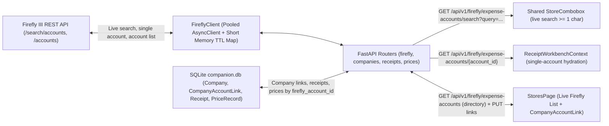

# Live Firefly Store Lookup, Optional Company Metadata & Type-Ahead Pickers

*   **Author:** Fabrizio
*   **Status:** Approved
*   **Date:** 2026-11-12

--------------------------------------------------------------------------------

## Overview

`my-firefly` is a companion hub for Firefly III that handles itemized grocery receipts, local receipt file archiving, and unit-normalized product price tracking. Today, every Firefly III expense account must be manually mapped one by one into a local `Store` table on the Stores page before it can be selected in the Receipt Workbench or Product Catalog, and every store must belong to a parent `Company`.

This design removes the manual `"Unmapped"` gate and drops the local `Store` copy table. `Receipt` and `PriceRecord` reference `firefly_account_id` directly while store searches and account name lookups use Firefly III's REST API live (REST API only, per `NG4`). SQLite (`companion.db`) stores only concepts that do not exist in Firefly III—specifically `Company` definitions and optional `(firefly_account_id, company_id)` grouping links (`CompanyAccountLink`) for future chain analytics. Store labels across the app use Firefly's account name directly, `StoresPage.tsx` simplifies around live account browsing and optional `Company` assignment, and `<select>` store dropdowns are replaced with type-ahead search pickers across all expense accounts.

## The Problem

1. **Manual Mapping Gate & Duplicate Store Copies:** Every Firefly III expense account starts in an `"Unmapped"` state until manually configured via `StoresPage.tsx` (`POST /api/v1/companies/quick-map`), which copies the account into a local `Store` table. With more than 290 expense accounts in Firefly III (spanning supermarket branches, independent local shops, utilities, and personal contacts), mapping accounts one by one blocks receipt entry and duplicates account records that already live in Firefly III.
2. **Mandatory Parent Company Coupling:** `Store.company_id` is currently required (`NOT NULL`), and `quick-map` forces the user to supply a parent `Company`. Independent single-location shops (such as a local bakery) do not belong to a retail chain, forcing users to create duplicate 1:1 `Company` records.
3. **Pervasive `Company — Store` Display & Ledger Side-Effects:** Frontend store selectors and history lists display `${company.name} — ${store.name}` (falling back to literal `"Company"` or `"Store"` placeholders when missing), `StoresPage.tsx` strips company prefixes out of `Store.name`, and Firefly transaction `group_title` generation in `receipts.py` overwrites the branch name with `company.name` whenever a parent `Company` is assigned.
4. **Unusable `<select>` Dropdowns and Arbitrary Defaults:** `WorkbenchHeader.tsx`, `CatalogPage.tsx`, and `WorkflowsPage.tsx` render plain HTML `<select>` controls over the full store/account list. Once 290+ accounts are active, native `<select>` menus are slow to scan, and `CatalogPage.tsx` / `WorkflowsPage.tsx` silently pre-select the first element (`stores[0]` / `exp[0]`), risking price logs or workflows targeting an unrelated non-shop account.

## Goals

*   **G1: Zero-Copy Live Firefly Integration:** Remove the local `Store` table and manual `"Unmapped"` gate; reference `firefly_account_id` directly on `Receipt` and `PriceRecord`, and resolve store search and account names live from Firefly III's REST API (REST API only, per `NG4`).
*   **G2: Authoritative Firefly Counterpart & Direct Validation:** Treat Firefly III as the sole source of expense accounts (retiring local store creation and `quick-map`), and validate `firefly_account_id` against Firefly III across receipt creation, receipt push, price logging, and company linking.
*   **G3: Optional Parent `Company` Link Metadata:** Replace `Store.company_id` with an optional `(firefly_account_id, company_id)` link table (`CompanyAccountLink`) in SQLite so standalone shops carry zero local metadata rows while chains can still be assigned, cleared, or deleted on `StoresPage.tsx` for upcoming chain analytics.
*   **G4: Uniform Firefly Account Name Display & Ledger Titles:** Display the live Firefly expense account name directly everywhere outside `Company` management—including `WorkbenchHeader.tsx`, `ReceiptWorkbenchPage.tsx`, `CatalogPage.tsx`, `ProductPriceChart.tsx`, and Firefly `group_title` generation—removing `Company —` prefixes and fallback placeholders.
*   **G5: Type-Ahead Store Pickers Without Auto-Defaults:** Replace plain `<select>` store/expense-account dropdowns in `WorkbenchHeader.tsx`, `CatalogPage.tsx`, and `WorkflowsPage.tsx` with a shared type-ahead picker that stays empty and runs no search queries until 1+ character is typed against Firefly III, hydrates persisted draft selections via a single-account lookup on reload, and starts unselected by default.
*   **G6: Simplified `StoresPage.tsx` & Default Landing Tab:** Remove `Mapped` / `Unmapped` warning tabs and amber badges from `StoresPage.tsx`, provide neutral filtering and pagination across live Firefly expense accounts alongside optional `Company` controls, and change the default landing tab in `App.tsx` from `'stores'` to `'workbench'`.

## Non-Goals

*   **NG1: Multi-Target & Liability-Account Receipt Splitting:** Splitting a single receipt across a store expense account and a friend's Firefly liability account (or general non-itemized transaction editing) is deferred to a separate follow-up design.
*   **NG2: Chain-Level (`Company`) Price Analytics:** Aggregating price trends, baselines, or deal scores by `company_id` in `prices.py` and `ProductPriceChart.tsx` is deferred to a follow-up design after `Company` metadata grouping is in place.
*   **NG3: Offline Mode & Persistent Local Store Caching:** Functioning without Firefly III reachable is excluded; `my-firefly` and Firefly III operate as one combined always-online service.
*   **NG4: Direct Firefly III Database Access:** Reading or writing Firefly III's database directly is excluded; all Firefly reads and writes use the official REST API.
*   **NG5: Automatic Company Guessing or Non-Shop Account Filtering:** Auto-creating `Company` rows by parsing account name prefixes or maintaining allowlist/blocklist filters to hide non-shop Firefly accounts is excluded.

## Open Questions

*   API shapes, migration steps, and file-level implementation details follow in Technical Plan and Detailed Implementation Plan.

## Critical User Journeys (CUJs)

### CUJ 1: Zero-Setup Receipt Entry Against Live Firefly Accounts
*   **Given:** The user has 290+ expense accounts in Firefly III, including `"Conad Via Roma"` and a standalone shop `"Panificio Rossi"`, and launches `my-firefly`.
*   **When:** The app opens directly on the Receipt Workbench (`'workbench'`), the user clicks the store picker, types `"pan"`, selects `"Panificio Rossi"` from the live suggestions, enters receipt items, and saves the receipt.
*   **Then:** No search query fires before typing; after typing `"pan"`, the picker queries Firefly III live and displays `"Panificio Rossi"`; the receipt persists directly against `firefly_account_id` without visiting `StoresPage.tsx` or creating a `Company`, and pushes to Firefly III with `group_title = "Panificio Rossi - <date>"`.

### CUJ 2: Reloading an In-Progress Receipt Draft
*   **Given:** The user started a receipt draft in the Receipt Workbench for `"Conad Via Roma"` (`fireflyAccountId` and ephemeral `fireflyAccountName` saved in `localStorage`) and refreshes the browser tab.
*   **When:** `ReceiptWorkbenchContext` hydrates the saved `fireflyAccountId`.
*   **Then:** The app fetches only that single account (`GET /api/v1/firefly/expense-accounts/{account_id}`) rather than listing all accounts, displays `"Conad Via Roma"` in the picker, and keeps Firefly push readiness intact. If the single lookup fails transiently, the input displays the cached name hint alongside an inline Retry button in `WorkbenchHeader.tsx`.

### CUJ 3: Recording a Product Price Without Accidental Auto-Selection
*   **Given:** The user opens the Log Price modal in `CatalogPage.tsx`.
*   **When:** The modal opens, the user types 1+ character in the store picker, selects a Firefly expense account explicitly (such as `"Lidl Corso Italia"`), and logs the price.
*   **Then:** The store picker starts blank (no `stores[0]` default), requires explicit selection before submission, saves `PriceRecord.firefly_account_id`, and displays `"Lidl Corso Italia"` directly in the Recorded Prices list and `ProductPriceChart` legend without `"Company —"` prefixes or `"Store"` placeholders.

### CUJ 4: Optional Chain Grouping & Legacy Cleanup on `StoresPage.tsx`
*   **Given:** The user opens `StoresPage.tsx` to group `"Conad Via Roma"` and `"Conad Via Etnea"` under `"Conad"` for future chain analytics, while leaving `"Panificio Rossi"` standalone.
*   **When:** The user browses live Firefly expense accounts (seeing neutral filters rather than `"Unmapped"` warnings), filters for `"Conad"`, assigns `Company = "Conad"` (persisting `CompanyAccountLink` rows), clears a legacy `Company` link from `"Panificio Rossi"` (deleting its `CompanyAccountLink` row), and deletes the unused legacy `Company` row. (The UI `"Standalone"` filter maps to `unassigned_only`.)
*   **Then:** `"Panificio Rossi"` has no local copy or company link in SQLite, `"Conad"` groups the two Conad accounts in `CompanyAccountLink`, and Receipt Workbench / Catalog / Firefly pushes continue displaying each account's live Firefly name unchanged.

--------------------------------------------------------------------------------

## Technical Plan (Architecture)

### 1. System Topology & Data Flow

`my-firefly` treats Firefly III as the single live source of expense accounts via REST API (REST API only, per `NG4`) and drops the local `Store` table. SQLite (`companion.db`) stores only companion-specific concepts (`Company`, `CompanyAccountLink`, `Product`, `Brand`, `Tag`, `Receipt`, `ReceiptItem`, `ReceiptAttachment`, and `PriceRecord`), referencing stores strictly by integer `firefly_account_id`.



### 2. Data Model & Migration (`companion.db`)

1. **Remove `Store`, Add `CompanyAccountLink` (`backend/app/models/company.py`):**
   * Remove `Store`, `StoreBase`, `StoreCreate`, and `StoreRead`.
   * Keep `Company`, `CompanyBase`, `CompanyCreate`, `CompanyRead`, and add `CompanyUpdate` (`name`, `default_category`, `notes`) and `CompanyWithCountRead` (`store_count: int`).
   * Add `CompanyAccountLink(SQLModel, table=True)`:
     * `firefly_account_id: int = Field(primary_key=True)`
     * `company_id: int = Field(foreign_key="company.id", index=True)`
     * `created_at: datetime = Field(default_factory=lambda: datetime.now(timezone.utc))`
   * Add `AccountCompanyAssign` request schema (`company_id: Optional[int] = None`, `company_name: Optional[str] = None`):
     * Passing both `None` clears the link (skipping the Firefly account check so deleted accounts can be unlinked).
     * Providing both `company_id` and `company_name` returns `422 Unprocessable Entity`.
     * Providing a non-empty `company_name` that contains only whitespace returns `422`.
     * Providing a non-existent `company_id` returns `404 Not Found`.
     * Reassigning an existing `firefly_account_id` upserts the row. Trimmed case-insensitive uniqueness is enforced for `company_name`.
2. **Update `Receipt` & `PriceRecord` (`backend/app/models/receipt.py`, `backend/app/models/price.py`):**
   * Replace `store_id: int = Field(foreign_key="store.id")` with `firefly_account_id: int = Field(index=True)` on table bases `ReceiptBase` and `PriceRecordBase`.
   * Update request schemas `ReceiptCreate` and `PriceRecordCreate` to accept `firefly_account_id: int`.
   * Update `ReceiptRead` and `PriceRecordRead` to expose `firefly_account_id: int` and `store_name: str` (hydrated from Firefly API at read time, removing nested `store` / `company` objects from operational reads).
3. **Alembic Migration (`0003_drop_store_use_firefly_account_id.py`):**
   * Mandate `PRAGMA foreign_keys = ON`, `PRAGMA journal_mode = WAL`, and `PRAGMA busy_timeout = 5000` in `backend/app/core/database.py`.
   * Create `companyaccountlink` table (`firefly_account_id` PK, `company_id` FK -> `company.id`, `created_at`).
   * Migrate existing `(store.firefly_account_id, store.company_id)` pairs into `companyaccountlink` where `store.firefly_account_id IS NOT NULL` and `store.company_id IS NOT NULL`.
   * Pre-check before dropping `store`: fail migration explicitly with an actionable error if any `receipt` or `pricerecord` row references a `store` whose `firefly_account_id IS NULL`, printing offending `store.id`, `store.name`, affected row counts, and copy-pasteable `sqlite3` repair commands.
   * Use `op.batch_alter_table` (`render_as_batch=True` in `migrations/env.py`) on `receipt` and `pricerecord`: add `firefly_account_id` (`sa.Integer()`, nullable initially), populate it from `store.firefly_account_id` via SQL `UPDATE`, enforce `nullable=False`, create `ix_receipt_firefly_account_id` and `ix_pricerecord_firefly_account_id`, and drop `store_id` FK/index/column.
   * Drop `store` table.
   * `downgrade()`: recreate `store` (with `company_id` referencing a fallback `"Unassigned"` `Company` row created via `INSERT OR IGNORE` to maintain `NOT NULL` schema parity), synthesize `Store.name = 'Account #' || firefly_account_id`, repopulate `store` from distinct `firefly_account_id` values across `receipt`, `pricerecord`, and `companyaccountlink`, restore `store_id` on `receipt` and `pricerecord`, and drop `companyaccountlink`. Custom branch labels and addresses dropped during `upgrade()` are permanently lost unless the pre-upgrade `./data/companion.db` backup is restored.

### 3. Live Firefly REST Client & Name Hydration (`backend/app/services/firefly.py`)

1. **Shared Connection Pool:**
   * Hold a lazy/shared `httpx.AsyncClient` on `FireflyClient` (closed cleanly in FastAPI `lifespan()` shutdown) instead of allocating a new client on every page request.
2. **Live Endpoints Used:**
   * `search_expense_accounts(query: str, limit: int = 20, active_only: bool = True)`: calls `GET /api/v1/search/accounts` with `query`, `type=expense`, `field=name`. Over-fetches defensively (up to `min(100, limit * 3)`), filters `attributes.active == True` when `active_only=True`, sorts alphabetically, and truncates to `limit`.
   * `get_expense_account(account_id: int)`: calls `GET /api/v1/accounts/{account_id}`. Verifies `attributes.type == "expense"`; returns `None` on `404` or if `attributes.type != "expense"`. Raises `502 Bad Gateway` on upstream network or auth failures.
   * `get_all_expense_accounts()`: reuses the shared `AsyncClient` across paginated `/api/v1/accounts?type=expense&limit=100` calls (with `max_pages = 100` safety bound, logging a warning if reached) for `StoresPage` directory browsing.
3. **Short-Lived In-Memory Name Cache (Non-DB):**
   * Maintain a process-local in-memory TTL map (`TTL = 60s`, max 500 entries, LRU eviction, process-local for single-worker deployment) inside `FireflyClient` for `resolve_expense_account_names(account_ids: set[int]) -> dict[int, str]`:
     * Used by `GET /api/v1/receipts/`, `GET /api/v1/receipts/{id}`, `GET /api/v1/prices/history/{product_id}`, and `POST /api/v1/receipts/` / `POST /api/v1/prices/`.
     * Identifies the missing subset of IDs: fetches single accounts concurrently via `get_expense_account` (`asyncio.gather`) if `len(missing) <= 5`, or refreshes the in-memory map via `get_all_expense_accounts()` protected by an `asyncio.Lock` (singleflight) if `len(missing) > 5`.
     * Caches `404` misses negatively in the TTL map as `"Deleted Firefly Account #<id>"` for 60s to prevent repeated sweep storms.
     * Graceful degradation: on `httpx.HTTPError` or connection timeout during read or post-commit response hydration paths (`GET /api/v1/receipts/`, `GET /api/v1/receipts/{id}`, `GET /api/v1/prices/history/{product_id}`, and `create_receipt` response serialization), falls back to `"Account #<id>"` so local history remains accessible. Strict `502` is raised only on write validation (`POST /api/v1/prices/`, `PUT /api/v1/companies/accounts/{account_id}/company`) and receipt push (`push_receipt_to_firefly`).

### 4. Backend API Changes

1. **Firefly Router (`backend/app/api/v1/firefly.py`):**
   * `GET /api/v1/firefly/expense-accounts/search`:
     * Query params: `query: str`, `limit: int = 20`, `active_only: bool = True`.
     * Dedicated autocomplete route for `StoreCombobox`. Calls `firefly_client.search_expense_accounts(query, limit, active_only)` and returns lightweight matches (`list[FireflyExpenseAccountBrief]` with `{ id, name, active }`).
   * `GET /api/v1/firefly/expense-accounts`:
     * Query params: `active_only: bool = True`, `company_id: Optional[int] = None`, `unassigned_only: bool = False`.
     * Directory browsing route for `StoresPage.tsx`. Fetches live accounts via `firefly_client.get_all_expense_accounts()`, joins local `CompanyAccountLink` + `Company` from SQLite (single `select(CompanyAccountLink).options(selectinload(CompanyAccountLink.company))`), applies filters, sorts by name, and returns the full directory list. Client-side pagination and filtering on `StoresPage.tsx` eliminates repeated upstream Firefly sweeps.
   * `GET /api/v1/firefly/expense-accounts/{account_id}`: live single-account lookup returning `{ id, name, active, company_id, company_name }`. Returns `404` if not found in Firefly or if `attributes.type != "expense"`.
2. **Companies Router (`backend/app/api/v1/companies.py`):**
   * `GET /api/v1/companies/`: list all `Company` rows with `store_count` aggregated from `CompanyAccountLink`.
   * `POST /api/v1/companies/`: trimmed case-insensitive uniqueness check (`400` on collision).
   * `PATCH /api/v1/companies/{company_id}`: trimmed case-insensitive uniqueness check (`400` on collision, `404` if missing).
   * `DELETE /api/v1/companies/{company_id}`: returns `404` if company not found; deletes matching `CompanyAccountLink` rows in the same transaction before deleting the `Company`.
   * `PUT /api/v1/companies/accounts/{account_id}/company`: accepts `AccountCompanyAssign`. If both `company_id` and `company_name` are `None`, deletes any link for `account_id` (skipping Firefly lookup). Validates mutual exclusion and non-empty `company_name` (`422`). Verifies `company_id` exists in SQLite (`404` if missing). Verifies `account_id` exists and is an expense account in Firefly via `get_expense_account` (`404` if missing or non-expense). Upserts `CompanyAccountLink`.
   * Retire `GET /api/v1/companies/stores`, `POST /api/v1/companies/stores`, and `POST /api/v1/companies/quick-map`.
3. **Receipts & Prices Routers (`backend/app/api/v1/receipts.py`, `backend/app/api/v1/prices.py`):**
   * Convert route handlers awaiting `firefly_client` to `async def`, executing network calls outside SQLite write transactions.
   * `receipts.py`: `POST /api/v1/receipts/` validates `firefly_account_id` via `firefly_client.get_expense_account` upfront (`404` if missing/non-expense, `400` if inactive) before opening the SQLite write transaction. Hydrates `store_name` on response with fallback to `"Account #<id>"` on transient Firefly error. In `push_receipt_to_firefly`, `_validate_firefly_accounts` verifies account is active (`400` if inactive), and `_build_firefly_tx_payload` passes `destination_id = str(receipt.firefly_account_id)` and `group_title = f"{account_name} - {receipt.purchase_date}"` using the live Firefly account name directly.
   * `prices.py`: accept `PriceRecordCreate.firefly_account_id`, verify account existence and expense type via `firefly_client.get_expense_account` (`404` if missing/non-expense, `400` if inactive) before opening the SQLite write transaction, and hydrate `store_name` on `GET /api/v1/prices/history/{product_id}` and `POST /api/v1/prices/` with graceful degradation.

### 5. Frontend Architecture & UI Changes

1. **Types & API Client (`frontend/src/types/index.ts`, `frontend/src/api/client.ts`):**
   * Replace `Store` with `FireflyExpenseAccount` (`id`, `name`, `active`, `company_id?: number | null`, `company_name?: string | null`) and update `ReceiptCreatePayload`, `ReceiptRecord`, and `PriceRecord` (`store_id`/`store` -> `firefly_account_id`/`store_name`).
   * Add `api.firefly.searchExpenseAccounts(query, limit, signal?)`, `api.firefly.getExpenseAccount(id)`, `api.companies.assignAccountCompany(accountId, payload)`, `api.companies.update(id, data)`, and `api.companies.delete(id)`; remove `listStores` and `quickMap`.
2. **Shared `StoreCombobox` (`frontend/src/components/common/StoreCombobox.tsx`):**
   * Modeled on `ProductCombobox.tsx` keyboard/outside-click handling, issuing **zero queries and keeping the suggestion list empty/closed until `query.trim().length >= 1`**.
   * At `>= 1` char: `150ms` debounce calling `api.firefly.searchExpenseAccounts(query.trim(), 20)` with `AbortController` canceling superseded requests. Suggestion items use `onMouseDown={(e) => e.preventDefault()}` so selection commits before input blur fires.
   * On zero matches: display `"No matching Firefly expense account. Create it in Firefly III, then retry."` with a `"Retry Search"` button.
   * On network/Firefly failure: display dedicated error UI (`"Failed to connect to Firefly III"` + `"Retry"` button).
   * On blur without selection: revert input text to `selectedAccount?.name ?? ""`; if query is dirty on form submission, require explicit selection. Provide a Clear (`X`) button.
3. **Draft Hydration, Pickers & Uniform Name Display:**
   * `ReceiptWorkbenchContext.tsx`: persist `fireflyAccountId: number | null` and ephemeral `fireflyAccountName?: string` hint in `localStorage`. On mount, if `fireflyAccountId` is present, hydrate via `api.firefly.getExpenseAccount(fireflyAccountId)`. If lookup fails, retain `fireflyAccountName` (or `'Account #' + fireflyAccountId`) with an inline Retry button in `WorkbenchHeader.tsx`. If legacy `storeId` is detected, clear it and show a non-blocking notification prompting store re-selection.
   * Compute `canPushToFirefly` from:
     `Boolean(selectedAccount && selectedAccount.active !== false && sourceAccountId && isBalanced && items.length > 0 && (!hasSplitVouchers || voucherAccountId))`
   * `WorkbenchHeader.tsx`: swap `<select>` for `StoreCombobox`, remove `(Unmapped)` option suffix and amber `Unmapped` pill, and surface an inline Retry button if account lookup fails.
   * `ReceiptWorkbenchPage.tsx`: display `{receipt.store_name || 'Account #' + receipt.firefly_account_id}` in Recent Receipts and update `getPushDisabledReasons` to require an active Firefly expense account.
   * `CatalogPage.tsx`: replace `<select>` in Log Price modal with `StoreCombobox`, start `selectedPriceAccount` at `null` (removing `stores[0]` auto-default) with explicit validation on submit, and display `{r.store_name || 'Account #' + r.firefly_account_id}` in Recorded Prices.
   * `ProductPriceChart.tsx`: group series by `record.firefly_account_id` and update `getStoreLabel` to return `record.store_name || 'Account #' + record.firefly_account_id`.
   * `WorkflowsPage.tsx`: replace both expense-account `<select>` dropdowns (`destAccountId` for target retail expense accounts, `subExpenseAccountId` for split-voucher/reimbursement destination expense accounts, which is optional) with `StoreCombobox`, removing the eager account list load and `exp[0].id` auto-default.
   * `App.tsx`: change default `activeTab` from `'stores'` to `'workbench'`.
4. **Simplified `StoresPage.tsx`:**
   * Remove `All / Unmapped / Mapped` warning tabs, amber unmapped styling, and forced `Store / Branch Label` input.
   * Browse live Firefly expense accounts with search input, neutral filters (`All`, `In Company`, `Standalone` mapping to `unassigned_only`, or specific `Company`), and client-side pagination (`48` per page). Show an explicit error banner with a retry button if Firefly III is unreachable. Provide optional `"Assign / Clear Company"` control (`PUT /api/v1/companies/accounts/{account_id}/company`) and a `"Manage Companies"` panel (create, rename, delete with `store_count` visibility).

--------------------------------------------------------------------------------

## Alternatives Considered

### Alternative A: Direct Firefly III Database Reads + Local Metadata Tables
*   **Pros**: Allows cross-table queries without calling Firefly III's REST API.
*   **Cons**: Requires exposing Firefly III database credentials across containers/hosts, couples queries to Firefly's private internal SQL schema across upgrades, prevents cross-engine SQL joins against local SQLite (`companion.db`), and violates Non-Goal `NG4`.
*   **Reason for Rejection**: Requires exposing Firefly III database credentials across containers/hosts, couples queries to Firefly's private SQL schema across upgrades, prevents cross-engine SQL joins against `companion.db`, and violates `NG4`.

### Alternative B: Full Local `Store` Mirror Synced from Firefly (Startup / Periodic Daemon)
*   **Pros**: Works offline when Firefly III is down and keeps store searches purely inside SQLite without HTTP calls.
*   **Cons**: Duplicates 290+ Firefly expense accounts into SQLite, adds startup/daemon sync lifecycle, stale-cache drift, soft-archiving flags, and SQLite write-lock management for data already authoritative in Firefly III.
*   **Reason for Rejection**: Introduces synchronization lifecycle complexity, background daemon failure modes, stale-cache drift, and SQLite write-lock contention for data already authoritative in Firefly III, violating `NG3`.

### Alternative C: Lazy Local `Store` Anchor Table (With or Without Name Snapshot)
*   **Pros**: Keeps existing `Receipt.store_id` and `PriceRecord.store_id` foreign-key schema unchanged without migrating `receipt` and `pricerecord` to `firefly_account_id`.
*   **Cons**: Still creates and maintains a local `Store` copy table in SQLite for accounts already modeled in Firefly III, and either duplicates account names locally or adds an extra local ID indirection layer.
*   **Reason for Rejection**: Retains an unnecessary local anchor table in SQLite for entities already modeled in Firefly III, adding schema maintenance overhead and ID indirection without eliminating network lookups.

### Alternative D: Eager Preload of 290+ Accounts on Page Load
*   **Pros**: Instant client-side filtering on keystrokes without debounced search requests.
*   **Cons**: Fetches and parses all 290+ Firefly expense accounts across 3+ paginated HTTP calls on every Workbench, Catalog, and Workflows load before the user types anything.
*   **Reason for Rejection**: Multiplies startup latency and mobile data transfer on Workbench, Catalog, and Workflows page loads by downloading 290+ account records before any user interaction occurs.

### Alternative E: Deferring `Company` Controls on `StoresPage.tsx` Until Analytics Exists
*   **Pros**: Avoids building and maintaining `Company` assignment, clearing, and deletion UI before chain-level price aggregation consumes `company_id`.
*   **Cons**: Delays grouping multi-branch chains (`Conad`, `Lidl`) and removing legacy 1:1 `Company` entries until a future analytics release.
*   **Reason for Rejection**: Prevents grouping multi-branch retail chains (e.g. Conad, Lidl) and cleaning up legacy 1:1 `Company` entries during the migration, accumulating schema debt ahead of future analytics.

### Alternative F: Generic Multi-Target / Liability Receipt Editor
*   **Pros**: Enables splitting a single shopping receipt across a store expense account and a friend's Firefly liability account in one pass.
*   **Cons**: Firefly III does not permit mixing `withdrawal` splits and `transfer` splits inside one split-transaction group, `ReceiptItem` has no per-item destination field, and attributing store items to a friend's account corrupts `PriceRecord` history.
*   **Reason for Rejection**: Firefly III split transactions cannot mix withdrawal and transfer splits within a single split group, and attributing grocery items to friend liability accounts corrupts product price tracking history.

--------------------------------------------------------------------------------

## Non-Functional Requirements

*   **Security & Privacy**: Never log `FIREFLY_TOKEN` or raw `Authorization` headers; return sanitized `502` diagnostics when Firefly III is unreachable or rejects credentials. Store receipt metadata, prices, and company links strictly in local SQLite (`companion.db`) and uploaded receipt files on the local Docker volume (`data/receipts/`), with no third-party cloud storage (`NG5` in `receipt_workbench_and_price_analytics.md`).
*   **Performance & Latency**: Reuse a single `httpx.AsyncClient` connection pool inside `FireflyClient`; keep `StoreCombobox` idle until 1+ character is typed (`150ms` debounce, `AbortController`, `limit=20`); use a short-lived (`60s`) process-local in-memory TTL map (max 500 entries, LRU) for `resolve_expense_account_names` so reading 50 receipts or price history records does not trigger N+1 Firefly HTTP requests; handle directory browsing with client-side filtering on `StoresPage.tsx`; eagerly load `CompanyAccountLink.company` with `selectinload`.
*   **Rollout & Rollback**: `0003_drop_store_use_firefly_account_id.py` migrates `receipt` and `pricerecord` via `batch_alter_table` and fails cleanly before dropping `store` if any referenced `store` has `firefly_account_id IS NULL` (printing actionable `sqlite3` repair queries). Back up `./data/companion.db` before upgrading. `downgrade()` reconstructs `store` rows with synthetic `'Account #' || firefly_account_id` names attached to a fallback `"Unassigned"` `Company` before restoring `store_id` foreign keys; restoring custom branch labels and addresses requires restoring the pre-upgrade SQLite backup.

--------------------------------------------------------------------------------

## Risks & Mitigations

| Risk / Failure Mode | Impact | Severity | Mitigation Strategy |
| :--- | :--- | :--- | :--- |
| **Firefly III Downtime or Timeout** | Read and write operations fail if Firefly III is unavailable. | High | Local read views (`GET /api/v1/receipts/`, `GET /api/v1/prices/history/`) and post-commit receipt response serialization degrade gracefully to `"Account #<id>"`. Write validations (`POST /api/v1/prices/`, `PUT /api/v1/companies/...`) and receipt push fail cleanly with sanitized `502 Bad Gateway`. `StoreCombobox` surfaces a dedicated inline Retry state. |
| **Account Scaling Limit (>10,000 Accounts)** | Truncation in full account directory browsing if total accounts exceed pagination bounds. | Medium | `get_all_expense_accounts()` enforces `max_pages = 100` (`limit = 100`) and logs an explicit warning if the limit is encountered. |
| **Migration 0003 Startup Lockout on Unlinked Stores** | FastAPI startup fails during `lifespan()` if an unmapped store has associated receipts or prices. | High | Pre-check outputs explicit terminal diagnostics with offending `store.id`, `store.name`, affected row counts, and copy-pasteable `sqlite3` repair commands to link or clean up rows before restarting. |
| **In-Memory Cache Staleness across Multi-Worker Deployments** | Name changes in Firefly III may take up to 60s to reflect across process boundaries. | Low | 60-second TTL bounds staleness; single-worker deployment assumption is documented for single-user companion instance. |
| **Non-Expense Account Type Injection** | Binding asset, liability, or revenue accounts to receipt stores or company links. | High | `get_expense_account` strictly validates `attributes.type == "expense"`, rejecting non-expense account IDs with `404` or `400`. |

--------------------------------------------------------------------------------

## Additional Resources

*   [Store Mapping Removal, Optional Parent Company Metadata & Type-Ahead Store Pickers RFC (superseded earlier RFC)](./store_sync_and_optional_company.md)
*   [Receipt Workbench & Price Analytics Design](./receipt_workbench_and_price_analytics.md)

--------------------------------------------------------------------------------

## Future Improvements

*   **Multi-Target & Liability-Account Receipt Splitting**: Support splitting shared receipts with friends tracked via Firefly liability/person accounts without breaking `PriceRecord` store attribution or Firefly withdrawal/transfer group rules.
*   **Chain-Level (`Company`) Price Analytics**: Aggregate normalized price baselines, deal scores, and chart filters across sibling accounts sharing a `Company` via `CompanyAccountLink` in `prices.py` and `ProductPriceChart.tsx`.

--------------------------------------------------------------------------------

## Detailed Implementation Plan

### Target Files to Create/Modify

1. `backend/app/core/database.py` (Modify)
2. `backend/app/models/company.py` (Modify)
3. `backend/app/models/receipt.py` (Modify)
4. `backend/app/models/price.py` (Modify)
5. `backend/app/models/__init__.py` (Modify)
6. `backend/migrations/versions/0003_drop_store_use_firefly_account_id.py` (Create)
7. `backend/app/services/firefly.py` (Modify)
8. `backend/app/main.py` (Modify)
9. `backend/app/api/v1/firefly.py` (Modify)
10. `backend/app/api/v1/companies.py` (Modify)
11. `backend/app/api/v1/receipts.py` (Modify)
12. `backend/app/api/v1/prices.py` (Modify)
13. `backend/tests/test_receipt_workbench.py` (Modify)
14. `frontend/src/types/index.ts` (Modify)
15. `frontend/src/api/client.ts` (Modify)
16. `frontend/src/components/common/StoreCombobox.tsx` (Create)
17. `frontend/src/components/common/StoreCombobox.test.tsx` (Create)
18. `frontend/src/context/ReceiptWorkbenchContext.tsx` (Modify)
19. `frontend/src/components/workbench/WorkbenchHeader.tsx` (Modify)
20. `frontend/src/pages/ReceiptWorkbenchPage.tsx` (Modify)
21. `frontend/src/pages/CatalogPage.tsx` (Modify)
22. `frontend/src/components/charts/ProductPriceChart.tsx` (Modify)
23. `frontend/src/pages/WorkflowsPage.tsx` (Modify)
24. `frontend/src/pages/StoresPage.tsx` (Modify)
25. `frontend/src/App.tsx` (Modify)
26. `docs/designs/receipt_workbench_and_price_analytics.md` (Modify)

---

### Implementation Phases & Tasks

#### Phase 1: Database & Schema Migration

*   **Task 1: `backend/app/core/database.py` (Modify)**
    *   **Scope**: SQLite connection pragma listener.
    *   **Changes**: Register a SQLAlchemy `@event.listens_for(engine, "connect")` listener executing `PRAGMA foreign_keys = ON`, `PRAGMA journal_mode = WAL`, and `PRAGMA busy_timeout = 5000` on each new SQLite connection.
    *   **Rationale**: Enforces foreign key constraints and prevents database locking under concurrent reads.

*   **Task 2: `backend/app/models/company.py` (Modify)**
    *   **Scope**: SQLModel ORM models and schemas.
    *   **Changes**: Remove `Store`, `StoreBase`, `StoreCreate`, and `StoreRead`. Retain `Company`, `CompanyBase`, `CompanyCreate`, and `CompanyRead`. Add `CompanyUpdate` (optional `name`, `default_category`, `notes`), `CompanyWithCountRead` (`store_count: int = 0`), `CompanyAccountLink(SQLModel, table=True)` (`firefly_account_id: int` PK, `company_id: int` FK to `company.id` indexed, `created_at: datetime`, `company: Optional[Company] = Relationship(back_populates="account_links")`), and `AccountCompanyAssign` (`company_id: Optional[int] = None`, `company_name: Optional[str] = None`). Update `Company` to replace `stores: List["Store"]` with `account_links: List["CompanyAccountLink"] = Relationship(back_populates="company", cascade_delete=True)`.
    *   **Rationale**: Drops the local store table in favor of pure Firefly account IDs while maintaining optional company links and ORM relationships.

*   **Task 3: `backend/app/models/receipt.py` (Modify)**
    *   **Scope**: SQLModel ORM receipt models.
    *   **Changes**: Replace `store_id: int = Field(foreign_key="store.id")` with `firefly_account_id: int = Field(index=True)` on `ReceiptBase` and `ReceiptCreate`. Remove `store: Optional[Store]` relationship on `Receipt`. Replace `store: Optional[StoreRead]` with `store_name: str = ""` on `ReceiptRead`.
    *   **Rationale**: Direct persistence of Firefly expense account ID on receipts.

*   **Task 4: `backend/app/models/price.py` (Modify)**
    *   **Scope**: SQLModel ORM price models.
    *   **Changes**: Replace `store_id: int = Field(foreign_key="store.id")` with `firefly_account_id: int = Field(index=True)` on `PriceRecordBase` and `PriceRecordCreate`. Remove `store: Optional[Store]` relationship on `PriceRecord`. Replace `store: Optional[StoreRead]` with `store_name: str = ""` on `PriceRecordRead`.
    *   **Rationale**: Direct persistence of Firefly expense account ID on price observations.

*   **Task 5: `backend/app/models/__init__.py` (Modify)**
    *   **Scope**: Package exports.
    *   **Changes**: Remove `Store*` exports. Export `CompanyAccountLink`, `CompanyUpdate`, `CompanyWithCountRead`, and `AccountCompanyAssign`.
    *   **Rationale**: Synchronizes SQLModel metadata registration.

*   **Task 6: `backend/migrations/versions/0003_drop_store_use_firefly_account_id.py` (Create)**
    *   **Scope**: Alembic migration script.
    *   **Metadata**: `down_revision = "0002_receipt_workbench_fields"`.
    *   **Changes**:
        *   `upgrade()`:
            1. Create table `companyaccountlink` (`firefly_account_id INTEGER PRIMARY KEY`, `company_id INTEGER NOT NULL REFERENCES company(id) ON DELETE CASCADE`, `created_at DATETIME NOT NULL`).
            2. Validate pre-condition: verify that no `receipt` or `pricerecord` rows reference a `store` row where `firefly_account_id IS NULL`. If found, raise an explicit migration error aborting the upgrade.
            3. Populate `companyaccountlink`: `INSERT INTO companyaccountlink (firefly_account_id, company_id, created_at) SELECT firefly_account_id, company_id, CURRENT_TIMESTAMP FROM store WHERE store.company_id IS NOT NULL;`
            4. `op.batch_alter_table("receipt")`: add `firefly_account_id INTEGER`, populate via correlated subquery `UPDATE receipt SET firefly_account_id = (SELECT firefly_account_id FROM store WHERE store.id = receipt.store_id)`, alter column `nullable=False`, create index on `firefly_account_id`, drop column `store_id`.
            5. `op.batch_alter_table("pricerecord")`: add `firefly_account_id INTEGER`, populate via correlated subquery `UPDATE pricerecord SET firefly_account_id = (SELECT firefly_account_id FROM store WHERE store.id = pricerecord.store_id)`, alter column `nullable=False`, create index on `firefly_account_id`, drop column `store_id`.
            6. Drop table `store`.
        *   `downgrade()`: Recreate `store` table, backfill distinct `firefly_account_id`s from `receipt`, `pricerecord`, and `companyaccountlink` (assigning to fallback `"Unassigned"` `Company`), restore `store_id` FK columns, and drop `companyaccountlink`.
    *   **Rationale**: Safe in-place migration of existing companion SQLite databases without data loss.

*   **Checkpoint 1**: Verify database migrations and pre-checks:
    ```bash
    cd backend && alembic upgrade head
    ```

---

#### Phase 2: Firefly Client Service & In-Memory Caching

*   **Task 7: `backend/app/services/firefly.py` (Modify)**
    *   **Scope**: Async Firefly client service.
    *   **Changes**:
        *   Manage a shared, pooled `httpx.AsyncClient` with an explicit `aclose()` cleanup method.
        *   Enforce `max_pages = 100` safeguard in `_get_all_accounts_by_type`.
        *   Add `search_expense_accounts(query: str, limit: int = 20) -> list[dict]` calling Firefly `GET /api/v1/search/accounts` (`type=expense`, `field=name`).
        *   Add `get_expense_account(account_id: int) -> Optional[dict]` calling Firefly `GET /api/v1/accounts/{account_id}` (returning `None` on `404`).
        *   Add `resolve_expense_account_names(account_ids: set[int]) -> dict[int, str]` backed by a process-local 60-second TTL cache map (`_account_name_cache: dict[int, tuple[str, float]]`) with an `asyncio.Lock` serializing cache misses. Fetch up to 5 missing accounts concurrently via individual calls; fetch full directory sweep when missing accounts exceed 5. Return `"Deleted Firefly Account #<id>"` for missing/deleted accounts.
    *   **Rationale**: High-performance, N+1-safe account lookups and live type-ahead searches.

*   **Task 8: `backend/app/main.py` (Modify)**
    *   **Scope**: Application lifespan.
    *   **Changes**: Register `await firefly_client.aclose()` inside the FastAPI `lifespan()` shutdown block.
    *   **Rationale**: Prevents unclosed HTTP connection pool leaks on server shutdown.

*   **Checkpoint 2**: Verify Firefly service unit tests and caching:
    ```bash
    cd backend && pytest tests/test_firefly_service.py
    ```

---

#### Phase 3: Backend Routers & API Endpoints

*   **Task 9: `backend/app/api/v1/firefly.py` (Modify)**
    *   **Scope**: Firefly API router.
    *   **Changes**:
        *   Add dedicated autocomplete route: `GET /api/v1/firefly/expense-accounts/search` (accepting query param `query: str`, `limit: int = 20`) returning `list[FireflyExpenseAccountBrief]`.
        *   Retain `GET /api/v1/firefly/expense-accounts` as an unpaginated directory listing returning `list[FireflyExpenseAccount]` with hydrated `company_id` and `company_name` via `selectinload(CompanyAccountLink.company)`. Remove `is_mapped` and `mapped_store_*` fields.
        *   Add `GET /api/v1/firefly/expense-accounts/{account_id}` returning `{ id, name, active, company_id, company_name }` (`404` if not found in Firefly).
    *   **Rationale**: Separates instant type-ahead queries from full directory loads.

*   **Task 10: `backend/app/api/v1/companies.py` (Modify)**
    *   **Scope**: Company router.
    *   **Changes**:
        *   `GET /api/v1/companies/`: return `list[CompanyWithCountRead]` aggregating active `CompanyAccountLink` counts.
        *   `POST /api/v1/companies/`: apply trimmed case-insensitive uniqueness check (`func.lower(func.trim(Company.name)) == func.lower(func.trim(company_in.name))`).
        *   `PATCH /api/v1/companies/{company_id}`: apply trimmed case-insensitive check; return `200 OK` with `CompanyRead`.
        *   `DELETE /api/v1/companies/{company_id}`: delete linked `CompanyAccountLink` rows in the same transaction; return `204 No Content`.
        *   `PUT /api/v1/companies/accounts/{firefly_account_id}/company`: accept `AccountCompanyAssign`. Validate account existence via `get_expense_account` (`404` if missing). If both `company_id` and `company_name` are `None`, delete any existing link and return `204 No Content`. If provided, find or create the `Company` (trimmed case-insensitive) and upsert the `CompanyAccountLink`, returning `200 OK` with `CompanyAccountLinkRead`.
        *   Remove `get_stores`, `create_store`, and `quick_map_firefly_account`.
    *   **Rationale**: Replaces store mapping with optional company metadata assignment.

*   **Task 11: `backend/app/api/v1/receipts.py` (Modify)**
    *   **Scope**: Receipts router.
    *   **Changes**:
        *   Remove `Store` imports, joins, and `selectinload(Receipt.store)` from `_receipt_loader_options()`.
        *   Persist `ReceiptCreate.firefly_account_id`.
        *   Convert handlers awaiting Firefly client (`create_receipt`, `list_receipts`, `get_receipt`, `push_receipt_to_firefly`) to `async def`.
        *   Hydrate `ReceiptRead.store_name` via `await firefly_client.resolve_expense_account_names`.
        *   In `_validate_firefly_accounts`, verify `receipt.firefly_account_id` exists and is active in Firefly via `firefly_client.get_expense_account`.
        *   In `_build_firefly_tx_payload`, update signature to accept `account_name: str` explicitly; format `destination_id = str(receipt.firefly_account_id)` and `group_title = f"{account_name} - {receipt.purchase_date}"`.
    *   **Rationale**: Eliminates store dependencies and formats transaction titles uniformly.

*   **Task 12: `backend/app/api/v1/prices.py` (Modify)**
    *   **Scope**: Price observations router.
    *   **Changes**:
        *   Remove `Store` imports, joins, and `selectinload(PriceRecord.store)`.
        *   Convert handlers (`get_product_price_history`, `record_price`) to `async def`.
        *   In `record_price`: validate `firefly_account_id` via `firefly_client.get_expense_account` (`404` if missing) and persist `PriceRecord.firefly_account_id`.
        *   Hydrate `PriceRecordRead.store_name` via `await firefly_client.resolve_expense_account_names`.
    *   **Rationale**: Direct persistence of expense account IDs on price history.

*   **Task 13: `backend/tests/test_receipt_workbench.py` (Modify)**
    *   **Scope**: Backend test suite.
    *   **Changes**:
        *   Update `test_pre_workbench_db_upgrades_non_destructively` fixture to set `firefly_account_id = 99` so migration `0003` pre-check passes cleanly.
        *   Replace `Store` fixtures with `firefly_account_id` constants and mocked `FireflyClient` methods (`get_expense_account`, `search_expense_accounts`, `resolve_expense_account_names`).
        *   Update receipt/price payloads from `store_id` to `firefly_account_id`.
        *   Add tests for inactive/missing Firefly account rejection on push, `PUT /companies/accounts/{id}/company` assign/clear, and `0003` upgrade/downgrade.
    *   **Rationale**: Keeps test suite passing across all modified endpoints and migration steps.

*   **Checkpoint 3**: Run backend test suite:
    ```bash
    cd backend && pytest tests/test_receipt_workbench.py
    ```

---

#### Phase 4: Frontend API Client & Common Components

*   **Task 14: `frontend/src/types/index.ts` (Modify)**
    *   **Scope**: Domain types.
    *   **Changes**:
        *   Remove `Store` interface. Add `store_count?: number` on `Company`.
        *   Define `FireflyExpenseAccountBrief` (`id: number; name: string`).
        *   Update `FireflyExpenseAccount` (`id: number; name: string; active: boolean; company_id?: number | null; company_name?: string | null`).
        *   Replace `store_id` / `store` with `firefly_account_id: number` and `store_name?: string` on `PriceRecord`, `ReceiptCreatePayload`, and `ReceiptRecord`.
    *   **Rationale**: Aligns TypeScript contracts with store-less backend schemas.

*   **Task 15: `frontend/src/api/client.ts` (Modify)**
    *   **Scope**: Frontend API client.
    *   **Changes**:
        *   Add `api.firefly.searchExpenseAccounts(query: string, limit?: number, signal?: AbortSignal) -> Promise<FireflyExpenseAccountBrief[]>`.
        *   Add `api.firefly.listExpenseAccounts() -> Promise<FireflyExpenseAccount[]>`.
        *   Add `api.firefly.getExpenseAccount(id: number) -> Promise<FireflyExpenseAccount>`.
        *   Add `api.companies.assignAccountCompany(accountId: number, payload: { company_id?: number | null; company_name?: string | null })`.
        *   Add `api.companies.update(id: number, data: Partial<Company>)` and `api.companies.delete(id: number)`.
        *   Remove `api.companies.listStores` and `api.companies.quickMap`.
        *   Update `api.prices.record` payload to send `firefly_account_id`.
    *   **Rationale**: Exposes dedicated search, directory listing, and company link management to the UI.

*   **Task 16: `frontend/src/components/common/StoreCombobox.tsx` (Create)**
    *   **Scope**: Reusable type-ahead combobox component.
    *   **Contract**:
        ```typescript
        export interface StoreComboboxProps {
          value: number | null;
          accountNameHint?: string | null;
          onChange: (accountId: number | null, account: FireflyExpenseAccount | null) => void;
          disabled?: boolean;
          placeholder?: string;
          className?: string;
        }
        ```
    *   **Behavior**:
        *   Does not issue network requests on empty focus; begins debounced query (`150ms`) with `AbortController` only when `query.trim().length >= 1`.
        *   Full keyboard accessibility (`ArrowDown`, `ArrowUp`, `Enter`, `Escape`) with WAI-ARIA combobox semantics.
        *   Empty state: displays `"No matching Firefly expense account. Create it in Firefly III, then retry."` with retry button.
        *   Reverts uncommitted text to `accountNameHint ?? ""` on blur.
        *   Includes clear button (`X`) when an account is selected.
    *   **Rationale**: Seamless type-ahead across 290+ accounts without full upfront loads.

*   **Task 17: `frontend/src/components/common/StoreCombobox.test.tsx` (Create)**
    *   **Scope**: Component unit test suite.
    *   **Changes**: Test debounced search execution, keyboard navigation, selection, clearing, blur reset, and error/empty states using Vitest and React Testing Library.
    *   **Rationale**: Prevents UI regressions on critical receipt entry input.

*   **Checkpoint 4**: Run combobox unit test suite:
    ```bash
    cd frontend && npx vitest run src/components/common/StoreCombobox.test.tsx
    ```

---

#### Phase 5: Workbench Context & UI Page Integrations

*   **Task 18: `frontend/src/context/ReceiptWorkbenchContext.tsx` (Modify)**
    *   **Scope**: Workbench context and local draft storage.
    *   **Changes**:
        *   Replace `storeId` with `fireflyAccountId: number | null` and store `fireflyAccountName: string | null` in `localStorage` draft.
        *   Remove `stores` array and `refreshStores()` mount fetch.
        *   Manage `selectedAccount: FireflyExpenseAccount | null` and `setSelectedAccount: (account: FireflyExpenseAccount | null) => void`.
        *   Hydrate `selectedAccount` via `api.firefly.getExpenseAccount(fireflyAccountId)` on draft reload if account name is missing or inactive check is needed.
        *   Compute `canPushToFirefly = Boolean(selectedAccount && selectedAccount.active !== false && sourceAccountId && ...)`.
    *   **Rationale**: Eliminates store dependencies while preserving draft reload hydration.

*   **Task 19: `frontend/src/components/workbench/WorkbenchHeader.tsx` (Modify)**
    *   **Scope**: Workbench header component.
    *   **Changes**:
        *   Replace `<select>` store dropdown with `<StoreCombobox>`.
        *   Remove `(Unmapped)` option label and amber `Unmapped` pill.
        *   Update `handleSaveOrPush`: validate `!state.fireflyAccountId` (with user alert if missing) and set payload `firefly_account_id: state.fireflyAccountId`.
    *   **Rationale**: Removes unmapped UI gating and native dropdown bottlenecks from receipt entry.

*   **Task 20: `frontend/src/pages/ReceiptWorkbenchPage.tsx` (Modify)**
    *   **Scope**: Workbench page component.
    *   **Changes**:
        *   Display `{receipt.store_name || 'Account #' + receipt.firefly_account_id}` in Recent Receipts without `Company —` prefix.
        *   Update `getPushDisabledReasons` copy to mention selecting an active Firefly expense account.
    *   **Rationale**: Consistent Firefly account naming and validation feedback.

*   **Task 21: `frontend/src/pages/CatalogPage.tsx` (Modify)**
    *   **Scope**: Product catalog page.
    *   **Changes**:
        *   Remove eager `listStores()` fetch and `stores[0]` default selection.
        *   Replace Log Price store `<select>` with `<StoreCombobox>` (starting at `null`, validated on submit).
        *   Display `{r.store_name || 'Account #' + r.firefly_account_id}` in Recorded Prices.
    *   **Rationale**: Eliminates misattribution to first store in list and removes company prefixes.

*   **Task 22: `frontend/src/components/charts/ProductPriceChart.tsx` (Modify)**
    *   **Scope**: Price analytics chart component.
    *   **Changes**: Group plotted series by `record.firefly_account_id` instead of `record.store_id`, and set `getStoreLabel` to return `record.store_name || 'Account #' + record.firefly_account_id`.
    *   **Rationale**: Displays live Firefly account names in price trend legends and tooltips.

*   **Task 23: `frontend/src/pages/WorkflowsPage.tsx` (Modify)**
    *   **Scope**: Workflows page component.
    *   **Changes**: Replace expense-account `<select>` dropdowns (`destAccountId`, `subExpenseAccountId`) with `<StoreCombobox>`. Remove eager `getExpenseAccounts()` mount fetch and first-item auto-selection.
    *   **Rationale**: Eliminates 290+ `<select>` dropdowns and accidental misattributions.

*   **Task 24: `frontend/src/pages/StoresPage.tsx` (Modify)**
    *   **Scope**: Stores / expense accounts page.
    *   **Changes**:
        *   Load unpaginated directory once on mount via `api.firefly.listExpenseAccounts()` and cache in component state.
        *   Remove `All / Unmapped / Mapped` tabs, amber unmapped cards, and forced `Store / Branch Label` inputs.
        *   Provide search input and neutral filter pills (`All`, `In Company`, `Standalone`, or specific Company) with client-side filtering and pagination (`48` accounts per page).
        *   Replace `"Map Store"` with `"Assign / Clear Company"` modal calling `api.companies.assignAccountCompany`.
        *   Add `"Manage Companies"` modal/panel for CRUD with `store_count`.
    *   **Rationale**: Replaces mandatory store mapping with optional chain-metadata curation over live accounts.

*   **Task 25: `frontend/src/App.tsx` (Modify)**
    *   **Scope**: App root navigation.
    *   **Changes**: Change default `activeTab` from `'stores'` to `'workbench'`.
    *   **Rationale**: Direct entry into receipt processing on launch.

*   **Checkpoint 5**: Run frontend test suite and type check:
    ```bash
    cd frontend && npm test && npx tsc --noEmit
    ```

---

#### Phase 6: Documentation & E2E Verification

*   **Task 26: `docs/designs/receipt_workbench_and_price_analytics.md` (Modify)**
    *   **Scope**: Companion design documentation.
    *   **Changes**: Add an amendment cross-reference on Goal G8, `Store` table deprecation, and `WorkbenchHeader` UI updates linking to this superseding design.
    *   **Rationale**: Maintains zero documentation drift across designs.

---

### Verification Plan

*   **Compilation & Type Checking**:
    *   Backend syntax check:
        ```bash
        cd backend && python -m compileall app
        ```
    *   Frontend type check and production bundle:
        ```bash
        cd frontend && npx tsc --noEmit && npm run build
        ```

*   **Unit & Migration Tests**:
    *   Execute database migration to head and roll back:
        ```bash
        cd backend && alembic upgrade head && alembic downgrade -1 && alembic upgrade head
        ```
    *   Run backend unit test suite:
        ```bash
        cd backend && pytest
        ```
    *   Run frontend unit test suite:
        ```bash
        cd frontend && npm test
        ```

*   **End-to-End Functional Verification**:
    1. **Combobox Type-Ahead**: Verify in browser that `StoreCombobox` triggers zero network requests on empty focus, executes debounced query to `GET /api/v1/firefly/expense-accounts/search?query=...` on `>= 1` character, and keyboard navigates options cleanly.
    2. **Draft Reload**: Verify that saving a workbench draft with `fireflyAccountId`, refreshing the page, restores the selected expense account via single-account `GET /api/v1/firefly/expense-accounts/{id}` without full directory preloading.
    3. **Receipt Push**: Verify pushing a receipt formats transaction group title as `f"{account_name} - {purchase_date}"` without company prefix.
    4. **Stores Page Curation**: Verify `StoresPage.tsx` loads accounts once, filters and paginates client-side, allows assigning and clearing company links, and creates/deletes company records cleanly.

--------------------------------------------------------------------------------

*Drafted with EGM*
