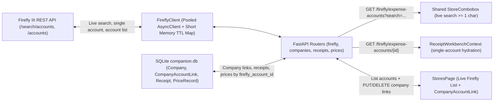

# Live Firefly Store Lookup, Optional Company Metadata & Type-Ahead Pickers

*   **Author:** Fabrizio
*   **Status:** Proposed
*   **Date:** 2026-11-12

--------------------------------------------------------------------------------

## Overview

`my-firefly` is a companion hub for Firefly III that handles itemized grocery receipts, local receipt file archiving, and unit-normalized product price tracking. Today, every Firefly III expense account must be manually mapped one by one into a local `Store` table on the Stores page before it can be selected in the Receipt Workbench or Product Catalog, and every store must belong to a parent `Company`.

This design removes the manual `"Unmapped"` gate and drops the local `Store` copy altogether. `Receipt` and `PriceRecord` reference `firefly_account_id` directly while store searches and account name lookups use Firefly III's REST API live (`NG4` preserved). SQLite (`companion.db`) stores only concepts that do not exist in Firefly III—specifically `Company` definitions and optional `(firefly_account_id, company_id)` grouping links (`CompanyAccountLink`) for future chain analytics. Store labels across the app use Firefly's account name directly, `StoresPage.tsx` simplifies around live account browsing and optional `Company` assignment, and `<select>` store dropdowns are replaced with type-ahead search pickers across 290+ accounts.

## The Problem

1. **Manual Mapping Gate & Duplicate Store Copies:** Every Firefly III expense account starts in an `"Unmapped"` state until manually configured via `StoresPage.tsx` (`POST /api/v1/companies/quick-map`), which copies the account into a local `Store` table. With more than 290 expense accounts in Firefly III (spanning supermarket branches, independent local shops, utilities, and personal contacts), mapping accounts one by one blocks receipt entry and duplicates account records that already live in Firefly III.
2. **Mandatory Parent Company Coupling:** `Store.company_id` is currently required (`NOT NULL`), and `quick-map` forces the user to supply a parent `Company`. Independent single-location shops (such as a local bakery) do not belong to a retail chain, forcing users to create duplicate 1:1 `Company` records just to use the store.
3. **Pervasive `Company — Store` Display & Ledger Side-Effects:** Frontend store selectors and history lists display `${company.name} — ${store.name}` (falling back to literal `"Company"` or `"Store"` placeholders when missing), `StoresPage.tsx` strips company prefixes out of `Store.name`, and Firefly transaction `group_title` generation in `receipts.py` overwrites the branch name with `company.name` whenever a parent `Company` is assigned.
4. **Unusable `<select>` Dropdowns and Arbitrary Defaults:** `WorkbenchHeader.tsx`, `CatalogPage.tsx`, and `WorkflowsPage.tsx` render plain HTML `<select>` controls over the full store/account list. Once 290+ accounts are active, native `<select>` menus are slow to scan, and `CatalogPage.tsx` / `WorkflowsPage.tsx` silently pre-select the first element (`stores[0]` / `exp[0]`), risking price logs or workflows targeting an unrelated non-shop account.

## Goals

*   **G1: Zero-Copy Live Firefly Integration:** Remove the local `Store` table and manual `"Unmapped"` gate; reference `firefly_account_id` directly on `Receipt` and `PriceRecord`, and resolve store search and account names live from Firefly III's REST API (`NG4` preserved).
*   **G2: Authoritative Firefly Counterpart & Direct Validation:** Treat Firefly III as the sole source of expense accounts (retiring local store creation and `quick-map`), and validate `firefly_account_id` against Firefly III before pushing receipts.
*   **G3: Optional Parent `Company` Link Metadata:** Replace `Store.company_id` with an optional `(firefly_account_id, company_id)` link table (`CompanyAccountLink`) in SQLite so standalone shops carry zero local metadata rows while chains can still be assigned, cleared, or deleted on `StoresPage.tsx` for upcoming chain analytics.
*   **G4: Uniform Firefly Account Name Display & Ledger Titles:** Display the live Firefly expense account name directly everywhere outside `Company` management—including `WorkbenchHeader.tsx`, `ReceiptWorkbenchPage.tsx`, `CatalogPage.tsx`, `ProductPriceChart.tsx`, and Firefly `group_title` generation—removing all `Company —` / `Store —` prefixes.
*   **G5: Type-Ahead Store Pickers Without Auto-Defaults:** Replace plain `<select>` store/expense-account dropdowns in `WorkbenchHeader.tsx`, `CatalogPage.tsx`, and `WorkflowsPage.tsx` with a shared type-ahead picker that stays empty and runs no search queries until 1+ character is typed against Firefly III, hydrates persisted draft selections via a single-account lookup on reload, and starts unselected by default.
*   **G6: Simplified `StoresPage.tsx` & Default Landing Tab:** Remove `Mapped` / `Unmapped` warning tabs and amber badges from `StoresPage.tsx`, provide neutral filtering and pagination across 290+ live Firefly expense accounts alongside optional `Company` controls, and change the default landing tab in `App.tsx` from `'stores'` to `'workbench'`.

## Non-Goals

*   **NG1: Multi-Target & Liability-Account Receipt Splitting:** Splitting a single receipt across a store expense account and a friend's Firefly liability account (or general non-itemized transaction editing) is deferred to a separate follow-up design.
*   **NG2: Chain-Level (`Company`) Price Analytics:** Aggregating price trends, baselines, or deal scores by `company_id` in `prices.py` and `ProductPriceChart.tsx` is deferred to a follow-up design after `Company` metadata grouping is in place.
*   **NG3: Offline Mode & Local Store Caching:** Functioning without Firefly III reachable is excluded; `my-firefly` and Firefly III operate as one combined always-online service.
*   **NG4: Direct Firefly III Database Access:** Reading or writing Firefly III's database directly remains excluded; all Firefly reads and writes use the official REST API.
*   **NG5: Automatic Company Guessing or Non-Shop Account Filtering:** Auto-creating `Company` rows by parsing account name prefixes or maintaining allowlist/blocklist filters to hide non-shop Firefly accounts is excluded.

## Open Questions

*   None currently open; API shapes, migration steps, and file-level implementation details follow in Technical Plan and Detailed Implementation Plan.

## Critical User Journeys (CUJs)

### CUJ 1: Zero-Setup Receipt Entry Against Live Firefly Accounts
*   **Given:** The user has 290+ expense accounts in Firefly III, including `"Conad Via Roma"` and a standalone shop `"Panificio Rossi"`, and launches `my-firefly`.
*   **When:** The app opens directly on the Receipt Workbench (`'workbench'`), and the user clicks the store picker and types `"pan"`.
*   **Then:** No search query fires before typing; after typing `"pan"`, the picker queries Firefly III live and displays `"Panificio Rossi"`, the user selects it without visiting `StoresPage.tsx` or creating a `Company`, enters receipt items, saves the receipt against `firefly_account_id`, and pushes it to Firefly III with `group_title = "Panificio Rossi - <date>"`.

### CUJ 2: Reloading an In-Progress Receipt Draft
*   **Given:** The user started a receipt draft in the Receipt Workbench for `"Conad Via Roma"` (`fireflyAccountId` saved in `localStorage`) and refreshes the browser tab.
*   **When:** `ReceiptWorkbenchContext` hydrates the saved `fireflyAccountId`.
*   **Then:** The app fetches only that single account (`GET /api/v1/firefly/expense-accounts/{accountId}`) rather than listing all 290+ accounts, displays `"Conad Via Roma"` in the picker, and keeps Firefly push readiness intact.

### CUJ 3: Recording a Product Price Without Accidental Auto-Selection
*   **Given:** The user opens the Log Price modal in `CatalogPage.tsx`.
*   **When:** The modal opens.
*   **Then:** The store picker starts blank (no `stores[0]` default), requires the user to type 1+ character and pick a Firefly expense account explicitly (such as `"Lidl Corso Italia"`), saves `PriceRecord.firefly_account_id`, and displays `"Lidl Corso Italia"` directly in the Recorded Prices list and `ProductPriceChart` legend without `"Company —"` or `"Store"` prefixes.

### CUJ 4: Optional Chain Grouping & Legacy Cleanup on `StoresPage.tsx`
*   **Given:** The user opens `StoresPage.tsx` to group `"Conad Via Roma"` and `"Conad Via Etnea"` under `"Conad"` for future chain analytics, while leaving `"Panificio Rossi"` standalone.
*   **When:** The user browses live Firefly expense accounts (seeing neutral filters rather than `"Unmapped"` warnings), filters for `"Conad"`, assigns `Company = "Conad"` (persisting `CompanyAccountLink` rows), clears a legacy `Company` link from `"Panificio Rossi"` (deleting its `CompanyAccountLink` row), and deletes the unused legacy `Company` row.
*   **Then:** `"Panificio Rossi"` has no local copy or company link in SQLite, `"Conad"` groups the two Conad accounts in `CompanyAccountLink`, and Receipt Workbench / Catalog / Firefly pushes continue displaying each account's live Firefly name unchanged.

## Technical Plan (Architecture)

### 1. System Topology & Data Flow

`my-firefly` treats Firefly III as the single live source of expense accounts via REST API (`NG4` preserved) and drops the local `Store` table. SQLite (`companion.db`) stores only companion-specific concepts (`Company`, `CompanyAccountLink`, `Product`, `Brand`, `Tag`, `Receipt`, `ReceiptItem`, `ReceiptAttachment`, and `PriceRecord`), referencing stores strictly by integer `firefly_account_id`.

### 2. Data Model & Migration (`companion.db`)

1. **Remove `Store`, Add `CompanyAccountLink` (`backend/app/models/company.py`):**
   * Remove `Store`, `StoreBase`, `StoreCreate`, and `StoreRead`.
   * Keep `Company`, `CompanyBase`, `CompanyCreate`, `CompanyRead`, and add `CompanyUpdate` (`name`, `default_category`, `notes`) and `CompanyWithCountRead` (`store_count: int`).
   * Add `CompanyAccountLink(SQLModel, table=True)`:
     * `firefly_account_id: int = Field(primary_key=True)`
     * `company_id: int = Field(foreign_key="company.id", index=True)`
     * `created_at: datetime = Field(default_factory=lambda: datetime.now(timezone.utc))`
   * Add `AccountCompanyAssign` request schema (`company_id: Optional[int] = None`, `company_name: Optional[str] = None`) where both `None` clears the link.
2. **Update `Receipt` & `PriceRecord` (`backend/app/models/receipt.py`, `backend/app/models/price.py`):**
   * Replace `store_id: int = Field(foreign_key="store.id")` with `firefly_account_id: int = Field(index=True)` on `ReceiptBase`, `ReceiptCreate`, `PriceRecordBase`, and `PriceRecordCreate`.
   * Update `ReceiptRead` and `PriceRecordRead` to expose `firefly_account_id: int` and `store_name: str` (hydrated from Firefly API at read time, removing nested `store` / `company` objects from operational reads).
3. **Alembic Migration (`0003_drop_store_use_firefly_account_id.py`):**
   * Create `companyaccountlink` table (`firefly_account_id` PK, `company_id` FK -> `company.id`, `created_at`).
   * Migrate existing `(store.firefly_account_id, store.company_id)` pairs into `companyaccountlink` where `store.firefly_account_id IS NOT NULL` and `store.company_id IS NOT NULL`.
   * Pre-check before dropping `store`: fail migration explicitly with an actionable error if any `receipt` or `pricerecord` row references a `store` whose `firefly_account_id IS NULL`.
   * Use `op.batch_alter_table` (`render_as_batch=True` in `migrations/env.py`) on `receipt` and `pricerecord`: add `firefly_account_id` (`sa.Integer()`, nullable initially), populate it from `store.firefly_account_id` via SQL `UPDATE`, enforce `nullable=False`, create `ix_receipt_firefly_account_id` and `ix_pricerecord_firefly_account_id`, and drop `store_id` FK/index/column.
   * Drop `store` table.
   * `downgrade()`: recreate `store` (with `company_id` nullable or linked to fallback `"Unassigned"` `Company`), repopulate `store` from distinct `firefly_account_id` values across `receipt`, `pricerecord`, and `companyaccountlink`, restore `store_id` on `receipt` and `pricerecord`, and drop `companyaccountlink`.

### 3. Live Firefly REST Client & Name Hydration (`backend/app/services/firefly.py`)

1. **Shared Connection Pool:**
   * Hold a lazy/shared `httpx.AsyncClient` on `FireflyClient` (closed cleanly in FastAPI `lifespan()` shutdown) instead of allocating a new client on every page request.
2. **Live Endpoints Used:**
   * `search_expense_accounts(query: str, limit: int = 20)`: calls `GET /api/v1/search/accounts` with `query`, `type=expense`, `field=name`, `limit` so type-ahead queries hit Firefly directly without loading all 290+ accounts.
   * `get_expense_account(account_id: int)`: calls `GET /api/v1/accounts/{account_id}` for single-account hydration (`ReceiptWorkbenchContext` reload and pre-push validation). Returns `None` on `404` and raises `502` on connectivity/auth errors.
   * `get_all_expense_accounts()`: reuses the shared `AsyncClient` across paginated `/api/v1/accounts?type=expense&limit=100` calls (with `max_pages = 100` safety bound) for `StoresPage` browsing and multi-ID hydration.
3. **Short-Lived In-Memory Name Cache (Non-DB):**
   * Maintain a process-local in-memory TTL map (`TTL = 60s`, zero SQLite persistence) inside `FireflyClient` for `resolve_expense_account_names(account_ids: set[int]) -> dict[int, str]`:
     * Used by `GET /api/v1/receipts/`, `GET /api/v1/receipts/{id}`, `GET /api/v1/prices/history/{product_id}`, and `POST /api/v1/prices/`.
     * When all requested `account_ids` are missing from the in-memory TTL map: fetch single accounts concurrently if `len(missing) <= 5` (`asyncio.gather`), or refresh the in-memory map via `get_all_expense_accounts()` if `len(missing) > 5` (avoiding N+1 HTTP calls across 50 receipts).
     * If a historical `firefly_account_id` no longer exists in Firefly (`404`), fall back to `"Deleted Firefly Account #<id>"` so historical receipts and price charts remain viewable.

### 4. Backend API Changes

1. **Firefly Router (`backend/app/api/v1/firefly.py`):**
   * `GET /api/v1/firefly/expense-accounts`:
     * Query params: `search: Optional[str] = None`, `company_id: Optional[int] = None`, `unassigned_only: bool = False`, `active_only: bool = True`, `limit: int = 50`, `offset: int = 0`.
     * When `search` is provided (for `StoreCombobox` at `>= 1` char) and no `company_id`/`unassigned_only` filter is requested: call `firefly_client.search_expense_accounts(search, limit)` directly and return lightweight matches (`{ id, name, active }`) without fetching all 290+ accounts or querying `Company`.
     * Otherwise (for `StoresPage` browsing): fetch live accounts via `firefly_client.get_all_expense_accounts()`, join local `CompanyAccountLink` + `Company` from SQLite (single `select(CompanyAccountLink).options(selectinload(CompanyAccountLink.company))`), apply `active_only`/`company_id`/`unassigned_only`/substring filters, sort by `name`, slice `[offset : offset + limit]`, and set `X-Total-Count` response header (exposed via CORS).
   * `GET /api/v1/firefly/expense-accounts/{account_id}`: live single-account lookup (`404` if not found in Firefly) for draft reload hydration and validation.
2. **Companies Router (`backend/app/api/v1/companies.py`):**
   * `GET /api/v1/companies/`: list all `Company` rows with `store_count` aggregated from `CompanyAccountLink`.
   * `POST /api/v1/companies/`, `PATCH /api/v1/companies/{company_id}` (trimmed case-insensitive uniqueness), and `DELETE /api/v1/companies/{company_id}` (deletes matching `CompanyAccountLink` rows in the same transaction before deleting the `Company`).
   * `PUT /api/v1/companies/accounts/{firefly_account_id}/company`: accepts `AccountCompanyAssign` (`company_id` or `company_name` trimmed/case-insensitive find-or-create; passing both `null` deletes any `CompanyAccountLink` row for `firefly_account_id`). Verify the `firefly_account_id` exists in Firefly via `get_expense_account` before creating a link.
   * Retire `GET /companies/stores`, `POST /companies/stores`, and `POST /companies/quick-map`.
3. **Receipts & Prices Routers (`backend/app/api/v1/receipts.py`, `backend/app/api/v1/prices.py`):**
   * `receipts.py`: accept `ReceiptCreate.firefly_account_id`, remove `Store` joins, hydrate `store_name` via `firefly_client.resolve_expense_account_names` on read/create responses, update `_validate_firefly_accounts` to verify `firefly_account_id` exists and is active in Firefly (`400` if deleted/inactive), and update `_build_firefly_tx_payload` to pass `destination_id = str(receipt.firefly_account_id)` and `group_title = f"{account_name} - {receipt.purchase_date}"` using the live Firefly account name directly.
   * `prices.py`: accept `PriceRecordCreate.firefly_account_id`, verify account existence via `firefly_client.get_expense_account(price_in.firefly_account_id)` (`404` if missing in Firefly), and hydrate `store_name` via `resolve_expense_account_names` on `GET /prices/history/{product_id}` and `POST /prices/`.

### 5. Frontend Architecture & UI Changes

1. **Types & API Client (`frontend/src/types/index.ts`, `frontend/src/api/client.ts`):**
   * Replace `Store` with `FireflyExpenseAccount` (`id`, `name`, `active`, `company_id?: number | null`, `company_name?: string | null`) and update `ReceiptCreatePayload`, `ReceiptRecord`, and `PriceRecord` (`store_id`/`store` -> `firefly_account_id`/`store_name`).
   * Add `api.firefly.searchExpenseAccounts(search, limit)`, `api.firefly.getExpenseAccount(id)`, `api.companies.assignAccountCompany(accountId, payload)`, `api.companies.update(id, data)`, and `api.companies.delete(id)`; remove `listStores` and `quickMap`.
2. **Shared `StoreCombobox` (`frontend/src/components/common/StoreCombobox.tsx`):**
   * Modeled on `ProductCombobox.tsx` keyboard/outside-click handling, issuing **zero queries and keeping the suggestion list empty/closed until `query.trim().length >= 1`**.
   * At `>= 1` char: `150ms` debounce calling `api.firefly.searchExpenseAccounts(query.trim(), 20)` with `AbortController` canceling superseded requests.
   * On zero matches: display `"No matching Firefly expense account. Create it in Firefly III, then retry."` with a `"Retry Search"` button.
   * On blur without selection: revert input text to `selectedAccount?.name ?? ""`; provide a Clear (`X`) button.
3. **Draft Hydration, Pickers & Uniform Name Display:**
   * `ReceiptWorkbenchContext.tsx`: rename persisted draft field `storeId` to `fireflyAccountId` (ignoring stale `storeId` from pre-migration `localStorage` drafts so old SQLite IDs cannot misbind to Firefly IDs). On mount, if `fireflyAccountId` is present in the restored draft, fetch only `api.firefly.getExpenseAccount(fireflyAccountId)` to populate `selectedAccount`. Compute `canPushToFirefly` from `Boolean(selectedAccount && selectedAccount.active !== false && sourceAccountId && ...)`.
   * `WorkbenchHeader.tsx`: swap `<select>` for `StoreCombobox`, remove `(Unmapped)` option suffix and amber `Unmapped` pill, and surface an explicit error banner if Firefly III is unreachable.
   * `ReceiptWorkbenchPage.tsx`: display `{receipt.store_name || 'Account #' + receipt.firefly_account_id}` in Recent Receipts and update `getPushDisabledReasons` to require an active Firefly expense account.
   * `CatalogPage.tsx`: replace `<select>` in Log Price modal with `StoreCombobox`, start `selectedPriceAccount` at `null` (removing `stores[0]` auto-default) with explicit validation on submit, and display `{r.store_name || 'Account #' + r.firefly_account_id}` in Recorded Prices.
   * `ProductPriceChart.tsx`: group series by `record.firefly_account_id` and update `getStoreLabel` to return `record.store_name || 'Account #' + record.firefly_account_id`.
   * `WorkflowsPage.tsx`: replace both `<select>` dropdowns (`destAccountId`, `subExpenseAccountId`) with `StoreCombobox`, removing the eager `getExpenseAccounts()` list load and `exp[0].id` auto-default.
   * `App.tsx`: change default `activeTab` from `'stores'` to `'workbench'`.
4. **Simplified `StoresPage.tsx`:**
   * Remove `All / Unmapped / Mapped` warning tabs, amber unmapped styling, and forced `Store / Branch Label` input.
   * Browse paginated live Firefly expense accounts (`limit=48`) with search input, neutral filters (`All`, `In Company`, `Standalone`, or specific `Company`), explicit error banner if Firefly III is unreachable, optional `"Assign / Clear Company"` control (`PUT /companies/accounts/{id}/company`), and a `"Manage Companies"` panel (create/rename/delete companies with `store_count` visibility).

## Alternatives Considered

### Alternative A: Direct Firefly III Database Reads + Local Metadata Tables
*   **Pros**: Allows cross-table queries without calling Firefly III's REST API.
*   **Cons**: Requires exposing Firefly III database credentials across containers/hosts, couples queries to Firefly's private internal SQL schema across upgrades, prevents cross-engine SQL joins against local SQLite (`companion.db`), and violates Non-Goal `NG4`.
*   **Reason for Rejection**: Rejected by author: violates `NG4` (REST API only) and breaks deployment/database isolation.

### Alternative B: Full Local `Store` Mirror Synced from Firefly (Startup / Periodic Daemon)
*   **Pros**: Works offline when Firefly III is down and keeps store searches purely inside SQLite without HTTP calls.
*   **Cons**: Duplicates 290+ Firefly expense accounts into SQLite, adds startup/daemon sync lifecycle, stale-cache drift, soft-archiving flags, and SQLite write-lock management for data already authoritative in Firefly III.
*   **Reason for Rejection**: Rejected by author: treat `my-firefly` and Firefly III as one combined always-online service, minimize duplicate copies in SQLite, and rely on Firefly III's REST API live.

### Alternative C: Lazy Local `Store` Anchor Table (With or Without Name Snapshot)
*   **Pros**: Keeps existing `Receipt.store_id` and `PriceRecord.store_id` foreign-key schema unchanged without migrating `receipt` and `pricerecord` to `firefly_account_id`.
*   **Cons**: Still creates and maintains a local `Store` copy table in SQLite for accounts already modeled in Firefly III, and either duplicates account names locally or adds an extra local ID indirection layer.
*   **Reason for Rejection**: Rejected by author: drop the `Store` table completely, store `firefly_account_id` directly on `Receipt` and `PriceRecord`, and keep only `Company` + `CompanyAccountLink` metadata in SQLite.

### Alternative D: Eager Preload of 290+ Accounts on Page Load
*   **Pros**: Instant client-side filtering on keystrokes without debounced search requests.
*   **Cons**: Fetches and parses all 290+ Firefly expense accounts across 3+ paginated HTTP calls on every Workbench, Catalog, and Workflows load before the user types anything.
*   **Reason for Rejection**: Rejected by author: `StoreCombobox` stays idle and issues zero search queries until 1+ character is entered (`GET /api/v1/firefly/expense-accounts?search=...`), pairing with a single-row lookup (`GET /api/v1/firefly/expense-accounts/{id}`) only when hydrating a saved draft.

### Alternative E: Deferring `Company` Controls on `StoresPage.tsx` Until Analytics Exists
*   **Pros**: Avoids building and maintaining `Company` assignment, clearing, and deletion UI before chain-level price aggregation consumes `company_id`.
*   **Cons**: Delays grouping multi-branch chains (`Conad`, `Lidl`) and removing legacy 1:1 `Company` entries until a future analytics release.
*   **Reason for Rejection**: Rejected by author: retain optional `Company` assignment, clearing, and deletion controls on `StoresPage.tsx` now so chain metadata can be curated ahead of analytics.

### Alternative F: Generic Multi-Target / Liability Receipt Editor
*   **Pros**: Enables splitting a single shopping receipt across a store expense account and a friend's Firefly liability account in one pass.
*   **Cons**: Firefly III does not permit mixing `withdrawal` splits and `transfer` splits inside one split-transaction group, `ReceiptItem` has no per-item destination field, and attributing store items to a friend's account corrupts `PriceRecord` history.
*   **Reason for Rejection**: Rejected by author: keep `my-firefly` focused on itemized retail receipts and defer multi-target/liability splitting to a separate follow-up item.

--------------------------------------------------------------------------------

## Non-Functional Requirements

*   **Security & Privacy**: Never log `FIREFLY_TOKEN` or raw `Authorization` headers; return sanitized `502` diagnostics when Firefly III is unreachable or rejects credentials. Keep all local receipts, prices, and company links strictly in local SQLite (`NG5` in `receipt_workbench_and_price_analytics.md`).
*   **Performance & Latency**: Reuse a single `httpx.AsyncClient` connection pool inside `FireflyClient`; keep `StoreCombobox` idle until 1+ character is typed (`150ms` debounce, `AbortController`, `limit=20`); use a short-lived (`60s`) process-local in-memory TTL map for `resolve_expense_account_names` so reading 50 receipts or price history records does not trigger N+1 Firefly HTTP requests; eagerly load `CompanyAccountLink.company` with `selectinload`.
*   **Rollout & Rollback**: `0003_drop_store_use_firefly_account_id.py` migrates `receipt` and `pricerecord` via `batch_alter_table` and fails cleanly before dropping `store` if any referenced `store` has `firefly_account_id IS NULL`. Back up `./data/companion.db` before upgrading. `downgrade()` reconstructs `store` rows from distinct `firefly_account_id` values across `receipt`, `pricerecord`, and `companyaccountlink` before restoring `store_id` foreign keys.

--------------------------------------------------------------------------------

### Additional Resources

*   [Store Sync, Optional Company & Type-Ahead Pickers RFC](./store_sync_and_optional_company.md)
*   [Receipt Workbench & Price Analytics Design](./receipt_workbench_and_price_analytics.md)

### Future Improvements

*   **Multi-Target & Liability-Account Receipt Splitting**: Support splitting shared receipts with friends tracked via Firefly liability/person accounts without breaking `PriceRecord` store attribution or Firefly withdrawal/transfer group rules.
*   **Chain-Level (`Company`) Price Analytics**: Aggregate normalized price baselines, deal scores, and chart filters across sibling accounts sharing a `Company` via `CompanyAccountLink` in `prices.py` and `ProductPriceChart.tsx`.

--------------------------------------------------------------------------------

## Detailed Implementation Plan

### Target Files to Create/Modify

#### 1. `backend/app/models/company.py` (Modify)
*   **Type / Scope**: SQLModel ORM & Pydantic Schemas
*   **Proposed Changes**: Remove `Store`, `StoreBase`, `StoreCreate`, and `StoreRead`. Retain `Company`, `CompanyBase`, `CompanyCreate`, and `CompanyRead`. Add `CompanyUpdate` (optional `name`, `default_category`, `notes`), `CompanyWithCountRead` (`store_count: int = 0`), `CompanyAccountLink(SQLModel, table=True)` (`firefly_account_id: int` PK, `company_id: int` FK to `company.id` indexed, `created_at: datetime`), and `AccountCompanyAssign` (`company_id: Optional[int] = None`, `company_name: Optional[str] = None`).
*   **Rationale**: Eliminates duplicate `Store` copies in SQLite while preserving optional chain-grouping metadata for future analytics.

#### 2. `backend/app/models/receipt.py` (Modify)
*   **Type / Scope**: SQLModel ORM & Pydantic Schemas
*   **Proposed Changes**: Replace `store_id: int = Field(foreign_key="store.id")` with `firefly_account_id: int = Field(index=True)` on `ReceiptBase` and `ReceiptCreate`, remove the `store: Optional[Store]` relationship on `Receipt`, and replace `store: Optional[StoreRead]` with `store_name: str = ""` on `ReceiptRead`.
*   **Rationale**: Links receipts directly to Firefly III expense accounts without local `Store` rows.

#### 3. `backend/app/models/price.py` (Modify)
*   **Type / Scope**: SQLModel ORM & Pydantic Schemas
*   **Proposed Changes**: Replace `store_id: int = Field(foreign_key="store.id")` with `firefly_account_id: int = Field(index=True)` on `PriceRecordBase` and `PriceRecordCreate`, remove the `store: Optional[Store]` relationship on `PriceRecord`, and replace `store: Optional[StoreRead]` with `store_name: str = ""` on `PriceRecordRead`.
*   **Rationale**: Links product price observations directly to Firefly III expense accounts while hydrating display names from Firefly at read time.

#### 4. `backend/app/models/__init__.py` (Modify)
*   **Type / Scope**: Python Package Exports
*   **Proposed Changes**: Remove `Store`, `StoreBase`, `StoreCreate`, `StoreRead` exports and export `CompanyAccountLink`, `CompanyUpdate`, `CompanyWithCountRead`, and `AccountCompanyAssign`.
*   **Rationale**: Keeps SQLModel metadata registration (`create_db_and_tables`) aligned with the updated schema.

#### 5. `backend/migrations/versions/0003_drop_store_use_firefly_account_id.py` (Create)
*   **Type / Scope**: Alembic Database Migration
*   **Proposed Changes**:
    *   `upgrade()`: Create `companyaccountlink`; verify no `receipt` or `pricerecord` references a `store` with `firefly_account_id IS NULL` (raising an explicit error if found); copy `(firefly_account_id, company_id)` pairs from `store` into `companyaccountlink`; use `op.batch_alter_table` on `receipt` and `pricerecord` to add `firefly_account_id`, backfill via join on `store.id`, enforce `nullable=False`, index `firefly_account_id`, and drop `store_id` FK/index/column; drop `store`.
    *   `downgrade()`: Recreate `store` (attaching ungrouped accounts to a fallback `"Unassigned"` `Company` row), repopulate `store` from distinct `firefly_account_id` values across `receipt`, `pricerecord`, and `companyaccountlink`, restore `store_id` foreign keys on `receipt` and `pricerecord`, and drop `companyaccountlink`.
*   **Rationale**: Migrates existing `companion.db` instances safely in-place without losing receipt, price, or company-grouping data.

#### 6. `backend/app/services/firefly.py` (Modify)
*   **Type / Scope**: Firefly III HTTP Client Service
*   **Proposed Changes**: Share a pooled `httpx.AsyncClient` on `FireflyClient` with an `aclose()` lifecycle method; enforce `max_pages = 100` in `_get_all_accounts_by_type`; add `search_expense_accounts(query: str, limit: int = 20)` calling `GET /api/v1/search/accounts` (`type=expense`, `field=name`); add `get_expense_account(account_id: int)` calling `GET /api/v1/accounts/{account_id}` (`None` on `404`); add `resolve_expense_account_names(account_ids: set[int]) -> dict[int, str]` backed by a process-local `60s` in-memory TTL map (single-account concurrent fetch for `<= 5` missing IDs, paginated sweep for `> 5`, `"Deleted Firefly Account #<id>"` fallback on `404`).
*   **Rationale**: Enables live type-ahead search, single-account draft hydration, pre-push verification, and N+1-free name resolution without persisting `Store` rows in SQLite.

#### 7. `backend/app/main.py` (Modify)
*   **Type / Scope**: FastAPI Lifespan & Middleware Configuration
*   **Proposed Changes**: Close `firefly_client` (`await firefly_client.aclose()`) on `lifespan()` shutdown, and add `expose_headers=["X-Total-Count"]` to `CORSMiddleware`.
*   **Rationale**: Cleans up pooled HTTP connections on shutdown and exposes pagination totals to the frontend.

#### 8. `backend/app/api/v1/firefly.py` (Modify)
*   **Type / Scope**: FastAPI Router (`/firefly`)
*   **Proposed Changes**:
    *   Update `GET /api/v1/firefly/expense-accounts` to accept `search`, `company_id`, `unassigned_only`, `active_only`, `limit`, `offset`, plus `Response` to set `X-Total-Count`. Route plain search queries (`search` set without `company_id`/`unassigned_only`) straight to `firefly_client.search_expense_accounts` (`limit` capped); for full directory browsing (`StoresPage`), fetch live accounts via `firefly_client.get_all_expense_accounts()`, load `CompanyAccountLink` + `Company` via `selectinload(CompanyAccountLink.company)`, apply filters/sort/pagination, and drop `is_mapped` / `mapped_store_*` fields.
    *   Add `GET /api/v1/firefly/expense-accounts/{account_id}` returning `{ id, name, active, company_id, company_name }` (`404` if missing in Firefly).
*   **Rationale**: Serves both zero-preload type-ahead queries (`>= 1` char), single-account draft hydration, and `StoresPage` directory browsing from Firefly live.

#### 9. `backend/app/api/v1/companies.py` (Modify)
*   **Type / Scope**: FastAPI Router (`/companies`)
*   **Proposed Changes**: Update `GET /api/v1/companies/` to return `list[CompanyWithCountRead]` (aggregating `CompanyAccountLink` counts); add `PATCH /api/v1/companies/{company_id}` (trimmed case-insensitive uniqueness check) and `DELETE /api/v1/companies/{company_id}` (deleting linked `CompanyAccountLink` rows in the same transaction); add `PUT /api/v1/companies/accounts/{firefly_account_id}/company` accepting `AccountCompanyAssign` (verifying account exists in Firefly via `get_expense_account`, finding/creating trimmed case-insensitive `Company`, or deleting the link when both `company_id` and `company_name` are `None`). Remove `get_stores`, `create_store`, and `quick_map_firefly_account`.
*   **Rationale**: Replaces mandatory store mapping with pure optional `Company` metadata management.

#### 10. `backend/app/api/v1/receipts.py` (Modify)
*   **Type / Scope**: FastAPI Router (`/receipts`)
*   **Proposed Changes**: Remove `Store` imports and joins; persist `ReceiptCreate.firefly_account_id`; update `list_receipts`, `get_receipt`, `create_receipt`, and `push_receipt_to_firefly` to populate `ReceiptRead.store_name` via `firefly_client.resolve_expense_account_names`; update `_validate_firefly_accounts` to verify `receipt.firefly_account_id` exists and is active in Firefly via `firefly_client.get_expense_account`; update `_build_firefly_tx_payload` to use `str(receipt.firefly_account_id)` for `destination_id` and `f"{account_name} - {receipt.purchase_date}"` for `group_title` (never `company.name`).
*   **Rationale**: Completes direct `firefly_account_id` persistence, live validation, and uniform Firefly account naming in transaction titles.

#### 11. `backend/app/api/v1/prices.py` (Modify)
*   **Type / Scope**: FastAPI Router (`/prices`)
*   **Proposed Changes**: Remove `Store` imports and joins; validate `firefly_account_id` via `firefly_client.get_expense_account` (`404` if missing) in `record_price`; persist `PriceRecord.firefly_account_id`; hydrate `PriceRecordRead.store_name` via `firefly_client.resolve_expense_account_names` in `get_product_price_history` and `record_price`.
*   **Rationale**: Aligns price logging and history endpoints with `firefly_account_id` and live account name resolution.

#### 12. `backend/tests/test_receipt_workbench.py` (Modify)
*   **Type / Scope**: Backend Unit & Migration Test Suite
*   **Proposed Changes**: Replace `Store` fixtures with `firefly_account_id` constants and mocked `FireflyClient` methods (`get_expense_account`, `search_expense_accounts`, `resolve_expense_account_names`); update receipt/price payloads from `store_id` to `firefly_account_id`; add tests for inactive/missing Firefly account rejection on push and `POST /prices/`, `PUT /companies/accounts/{id}/company` assign/clear, `PATCH`/`DELETE /companies/{id}`, and `0003` upgrade/downgrade against populated legacy `Store`/`Receipt`/`PriceRecord` rows (including pre-check failure when `firefly_account_id IS NULL`).
*   **Rationale**: Verifies API behavior, Firefly validation, and migration safety against real SQLite schemas.

#### 13. `frontend/src/types/index.ts` (Modify)
*   **Type / Scope**: TypeScript Domain Interfaces
*   **Proposed Changes**: Remove `Store`; add `store_count?: number` on `Company`; update `FireflyExpenseAccount` (`id`, `name`, `active`, `company_id?: number | null`, `company_name?: string | null`); replace `store_id` / `store` with `firefly_account_id: number` and `store_name?: string` on `PriceRecord`, `ReceiptCreatePayload`, and `ReceiptRecord`.
*   **Rationale**: Aligns frontend static types with the store-less API contracts.

#### 14. `frontend/src/api/client.ts` (Modify)
*   **Type / Scope**: Frontend HTTP Client
*   **Proposed Changes**: Add `api.firefly.searchExpenseAccounts(search, limit, signal?)`, `api.firefly.getExpenseAccount(id)`, `api.firefly.browseExpenseAccounts(params)` (reading `X-Total-Count` alongside JSON items), `api.companies.assignAccountCompany(accountId, payload)`, `api.companies.update(id, data)`, and `api.companies.delete(id)`; remove `api.companies.listStores` and `api.companies.quickMap`; update `api.prices.record` payload typing (`firefly_account_id`).
*   **Rationale**: Exposes live search, single-account hydration, paginated account directory browsing, and optional company linking to UI pages.

#### 15. `frontend/src/components/common/StoreCombobox.tsx` (Create)
*   **Type / Scope**: Reusable React Type-Ahead Picker Component
*   **Proposed Changes**: Implement keyboard-accessible (`ArrowDown`, `ArrowUp`, `Enter`, `Escape`) combobox modeled on `../workbench/ProductCombobox.tsx` that stays empty and triggers zero HTTP requests until `query.trim().length >= 1`, debounces `150ms` with `AbortController` calling `api.firefly.searchExpenseAccounts`, displays `"No matching Firefly expense account. Create it in Firefly III, then retry."` with a retry button on empty results, reverts uncommitted text to `selectedAccount?.name ?? ""` on blur, and exposes a clear (`X`) control.
*   **Rationale**: Keeps 290+ accounts navigable across all entry workflows without eager preloading or auto-selection.

#### 16. `frontend/src/context/ReceiptWorkbenchContext.tsx` (Modify)
*   **Type / Scope**: React Workbench State & Draft Persistence
*   **Proposed Changes**: Replace `storeId` with `fireflyAccountId: number | null` in `localStorage` draft schema (ignoring legacy `storeId` keys so old SQLite IDs cannot map to wrong Firefly IDs); remove `stores` array and `refreshStores()` mount fetch; maintain `selectedAccount: FireflyExpenseAccount | null` hydrated via single call to `api.firefly.getExpenseAccount(fireflyAccountId)` only when a draft restores a non-null `fireflyAccountId`; compute `canPushToFirefly` using `Boolean(selectedAccount && selectedAccount.active !== false && sourceAccountId && ...)`.
*   **Rationale**: Preserves instant draft reload hydration without preloading all 290+ accounts.

#### 17. `frontend/src/components/workbench/WorkbenchHeader.tsx` (Modify)
*   **Type / Scope**: React Workbench Header Component
*   **Proposed Changes**: Replace `<select>` with `StoreCombobox`, remove `(Unmapped)` option suffix and amber `Unmapped` pill, and show a concise warning badge/error only if a hydrated account is inactive or Firefly lookup failed.
*   **Rationale**: Removes the unmapped UI state and native `<select>` bottleneck from receipt entry.

#### 18. `frontend/src/pages/ReceiptWorkbenchPage.tsx` (Modify)
*   **Type / Scope**: React Page Component
*   **Proposed Changes**: Display `{receipt.store_name || 'Account #' + receipt.firefly_account_id}` directly in Recent Receipts without `Company —` or `'Store'` prefixes, and update `getPushDisabledReasons` copy to reference selecting an active Firefly expense account.
*   **Rationale**: Ensures uniform Firefly account naming in receipt history and accurate validation copy.

#### 19. `frontend/src/pages/CatalogPage.tsx` (Modify)
*   **Type / Scope**: React Page Component
*   **Proposed Changes**: Remove eager `api.companies.listStores()` fetch and `setPriceStoreId(stores[0]?.id || '')` default in `openPriceModal`; replace the Log Price `<select>` with `StoreCombobox` (starting at `null` with explicit validation on submit); display `{r.store_name || 'Account #' + r.firefly_account_id}` directly in Recorded Prices.
*   **Rationale**: Prevents silent misattribution to `stores[0]` across 290+ mixed accounts and removes `Company` prefixes.

#### 20. `frontend/src/components/charts/ProductPriceChart.tsx` (Modify)
*   **Type / Scope**: React Chart Component
*   **Proposed Changes**: Group plotted series by `record.firefly_account_id` instead of `record.store_id` and update `getStoreLabel` to return `record.store_name || 'Account #' + record.firefly_account_id`.
*   **Rationale**: Displays live Firefly account names uniformly in price trend legends and tooltips.

#### 21. `frontend/src/pages/WorkflowsPage.tsx` (Modify)
*   **Type / Scope**: React Page Component
*   **Proposed Changes**: Replace both expense-account `<select>` dropdowns (`destAccountId`, `subExpenseAccountId`) with `StoreCombobox` (`selectedAccount` objects), remove the eager `api.firefly.getExpenseAccounts()` load and `setDestAccountId(exp[0].id)` auto-default, and pass `selectedAccount.id` / `selectedAccount.name` into workflow API calls.
*   **Rationale**: Eliminates the remaining 290+ `<select>` controls and arbitrary first-item default.

#### 22. `frontend/src/pages/StoresPage.tsx` (Modify)
*   **Type / Scope**: React Page Component
*   **Proposed Changes**: Remove `All / Unmapped / Mapped` tabs, amber unmapped cards, and forced `Store / Branch Label` inputs; load paginated live accounts via `api.firefly.browseExpenseAccounts` (`limit=48`) with search input, neutral filters (`All`, `In Company`, `Standalone`, or by `Company`), and an error banner if Firefly is unreachable; replace `"Map Store"` with optional `"Assign / Clear Company"` (`api.companies.assignAccountCompany`) and add a `"Manage Companies"` panel (create, rename, delete with `store_count`).
*   **Rationale**: Replaces the mapping gate with optional chain-metadata curation over live Firefly accounts.

#### 23. `frontend/src/App.tsx` (Modify)
*   **Type / Scope**: React Root Navigation State
*   **Proposed Changes**: Change default `activeTab` from `'stores'` to `'workbench'`.
*   **Rationale**: Opens directly into receipt entry now that upfront store mapping is gone.

#### 24. `docs/designs/receipt_workbench_and_price_analytics.md` (Modify)
*   **Type / Scope**: Companion Design Documentation
*   **Proposed Changes**: Add a brief amendment note on Goal `G8`, `Store` table references, `group_title` behavior, and `WorkbenchHeader` UI notes linking to this superseding design.
*   **Rationale**: Keeps design documentation consistent across `docs/designs/`.

### Verification Plan

*   **Compilation/Build**: Run `cd frontend && npm run build` (`tsc && vite build`) to verify zero TypeScript or bundler errors after schema/type updates.
*   **Unit & Migration Tests**: Run `cd backend && python -m unittest discover -s tests` covering `0003` Alembic upgrade/downgrade (including `NULL` `firefly_account_id` pre-check), `CompanyAccountLink` CRUD, `Receipt` / `PriceRecord` live name hydration and `group_title`, and mocked `FireflyClient` searches/validation.
*   **Static Analysis & Linting**: Run `cd frontend && npm run lint` (if configured) and `cd backend && python -m py_compile` / project linter on modified modules.
*   **E2E/Integration**: Verify against a running Firefly III instance that `StoreCombobox` sends zero requests on empty focus, queries `/api/v1/firefly/expense-accounts?search=...` on `>= 1` character, reloads a `localStorage` draft via single-account `GET /api/v1/firefly/expense-accounts/{id}`, pushes receipts with Firefly account name `group_title`, and assigns/clears/deletes `Company` links on `StoresPage`.

--------------------------------------------------------------------------------

*Drafted with EGM*
